# Razor Pages Solution Template

A `dotnet new` and Visual Studio template that creates an ASP.NET Core solution: **two independent Razor Pages sites** (Internal and External, no Areas) that talk **only to an API layer**, which sits on a Services layer and an EF Core **SqlRepository** (repository pattern).

Like the [Shiny .NET templates](https://github.com/shinyorg/templates), all the choices are made in Visual Studio's **New Project** wizard, or with switches on the command line:

- the .NET version (LTS/STS)
- which projects to create
- the database, its version and the connection string
- authentication
- the jQuery, jQuery UI (and theme), Bootstrap (and Bootswatch theme) and Font Awesome Free versions
- error monitoring with Sentry, Raygun or Azure Application Insights
- sign-in with ASP.NET Core Identity (two-factor, passkeys, user admin UI), separate per site or single sign-on
- API documentation with Swagger UI or Scalar
- optional extras: DataTables, Select2, Toastr, SweetAlert2, Chart.js, Serilog, health checks, an API key, resilience and unit tests

Every client library is installed with **LibMan**.

<p align="center">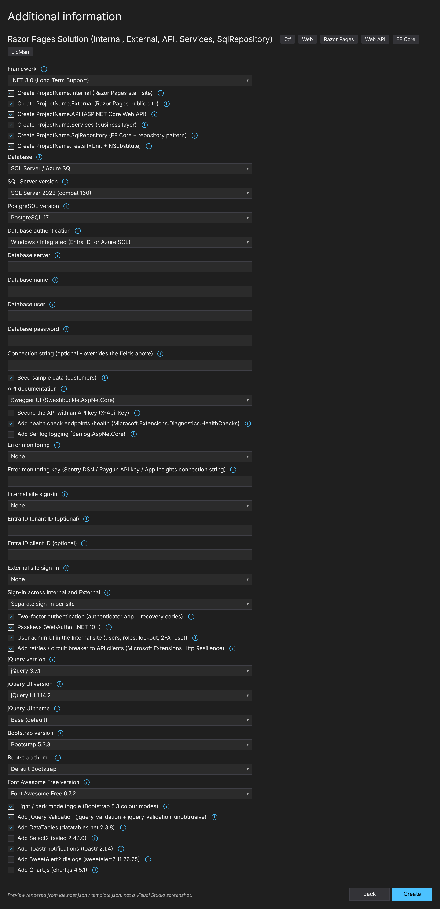</p>

<sub>Preview of Visual Studio's *Additional information* page for this template. It is rendered from the template's `ide.host.json` / `template.json` by [`docs/tools/render-wizard-preview.js`](docs/tools/render-wizard-preview.js), so it shows the same options, order, labels and defaults. It is not a Visual Studio capture.</sub>

---

## Contents

1. [The New Project wizard](#the-new-project-wizard)
2. [Multi-step wizard with Test connection (Visual Studio extension)](#multi-step-wizard-with-test-connection-visual-studio-extension)
3. [Web configurator (browser)](#web-configurator-browser)
4. [What you get](#what-you-get)
5. [Prerequisites](#prerequisites)
6. [Install the template](#install-the-template)
7. [Create a solution in Visual Studio](#create-a-solution-in-visual-studio)
8. [Create a solution from the command line](#create-a-solution-from-the-command-line)
9. [All options](#all-options)
10. [Run the generated solution](#run-the-generated-solution)
11. [Client-side libraries (LibMan)](#client-side-libraries-libman)
12. [Sign-in with ASP.NET Core Identity](#sign-in-with-aspnet-core-identity)
13. [Error monitoring (Sentry, Raygun, Application Insights)](#error-monitoring-sentry-raygun-application-insights)
14. [Database and EF Core](#database-and-ef-core)
15. [Update or uninstall the template](#update-or-uninstall-the-template)
16. [Troubleshooting](#troubleshooting)
17. [Working on the template](#working-on-the-template)

---

## The New Project wizard

After you name the solution, Visual Studio shows **Additional information**: one page with every option. Each option has an ⓘ tooltip, and the checkboxes show the NuGet or LibMan package they add.

| .NET version: LTS and STS | Database provider |
| --- | --- |
| 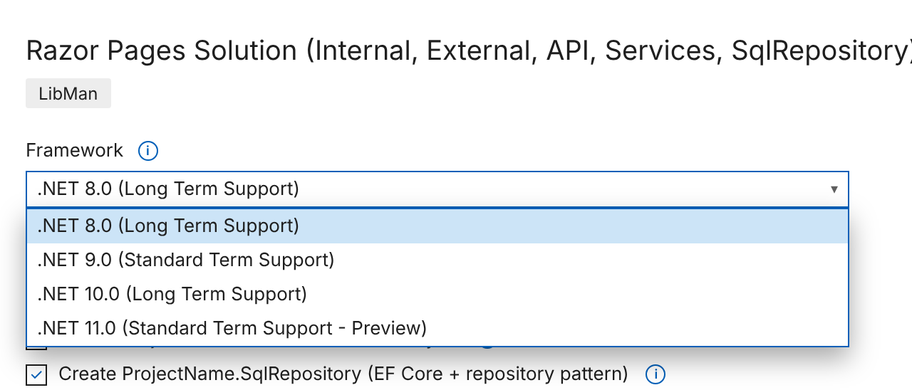 | 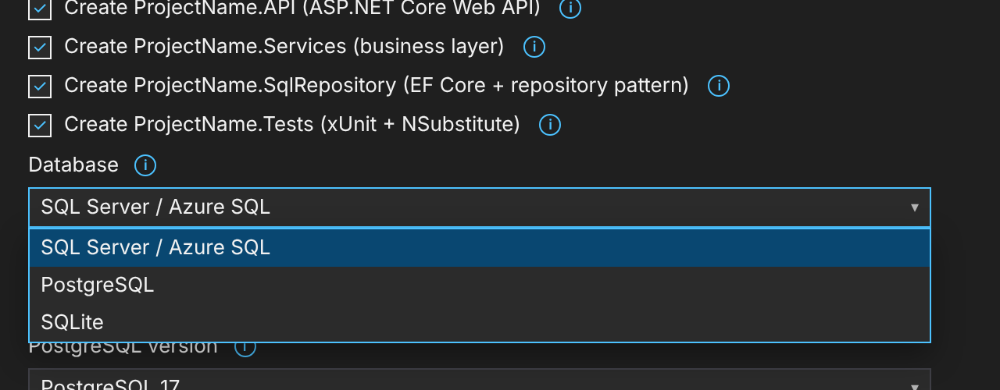 |
| **SQL Server version: sets EF Core's compatibility level** | **Internal site sign-in** |
| 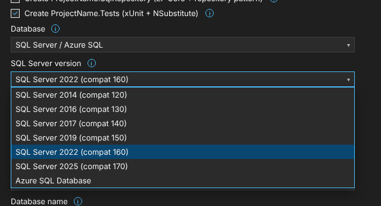 | 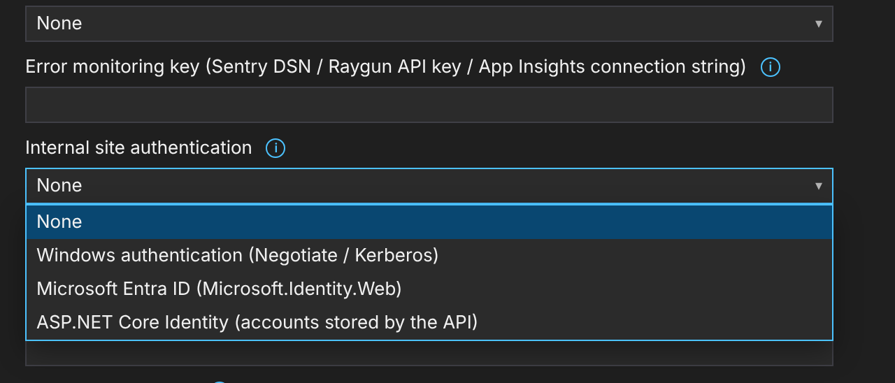 |
| **jQuery** | **jQuery UI** |
| 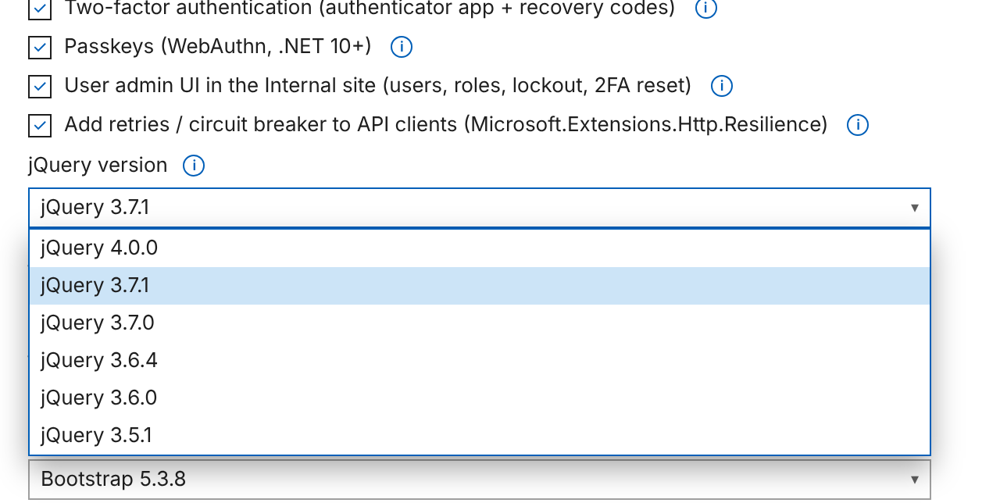 | 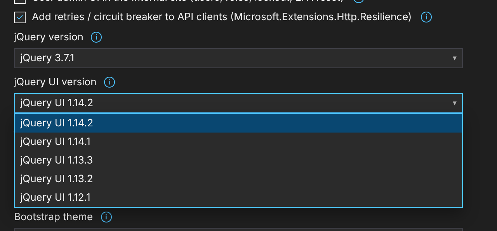 |
| **jQuery UI theme: all 25 ThemeRoller themes** | **Bootstrap** |
| 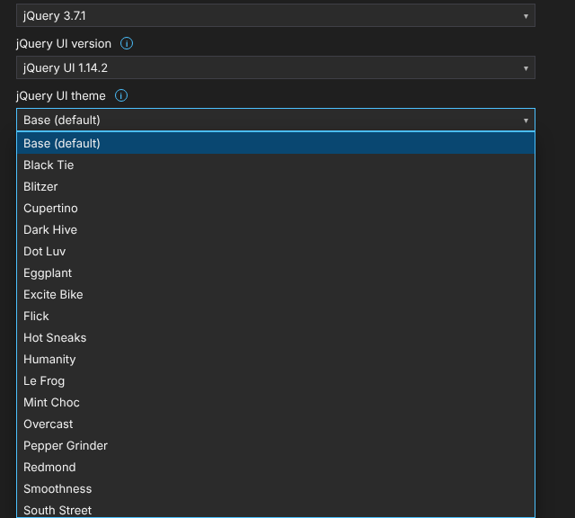 | 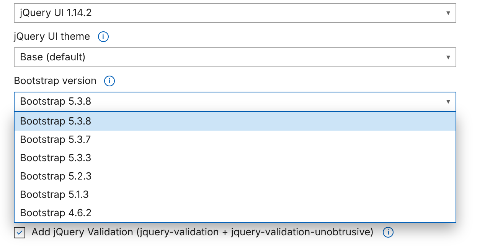 |
| **Bootstrap theme: Bootswatch** | **Font Awesome Free** |
| 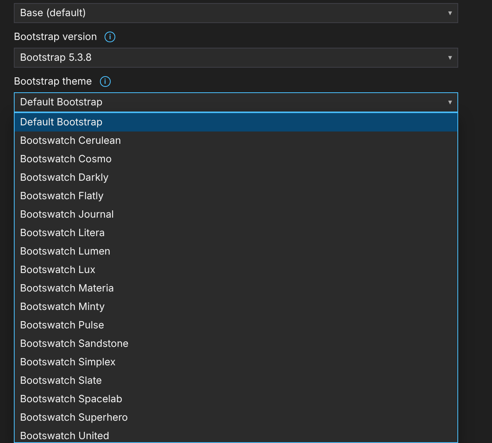 | 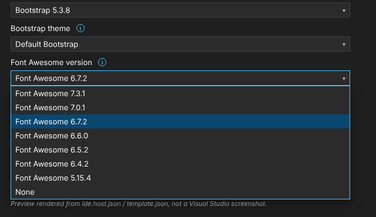 |
| **Error monitoring** | **External site sign-in** |
| 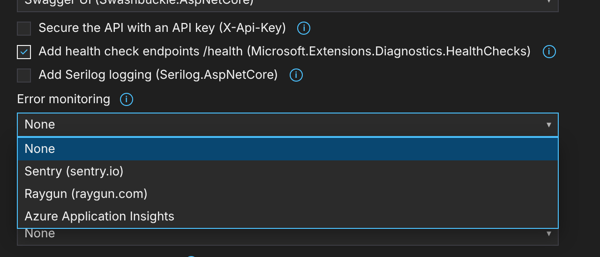 | 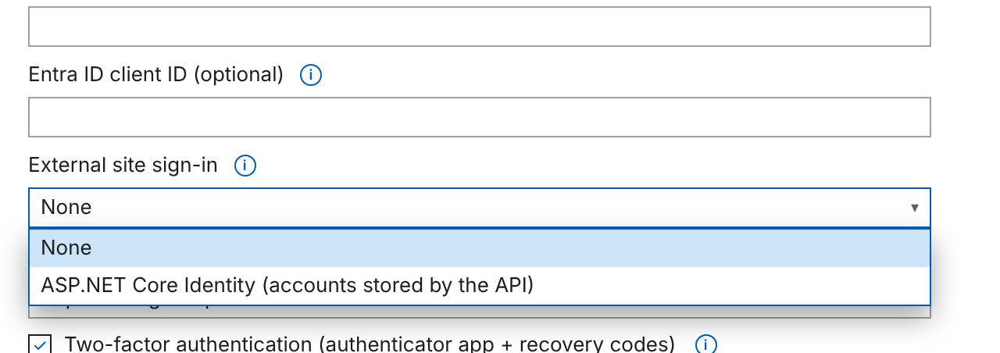 |

<details>
<summary>Light theme</summary>

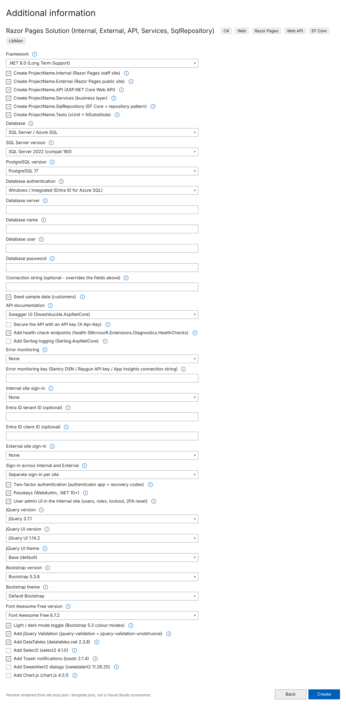

</details>

Visual Studio remembers your choices (checkboxes and versions) for the next solution you create from the template. It does not remember connection details or Entra IDs.

---

## Multi-step wizard with Test connection (Visual Studio extension)

Visual Studio always shows a `dotnet new` template's options on **one** *Additional information* page, and that page can't have buttons. For a real step-by-step wizard with **Back / Next** and a **Test connection** button, install the **Razor Pages Solution Wizard** extension (`wizard/`). It adds a second New Project entry, **Razor Pages Solution (Wizard)**.

Choices are **big selectable tiles**, like a web template builder:
- .NET versions show **LTS / STS** badges and their support dates.
- Databases and sign-in options have icons and a short explanation.
- Version pickers are compact tiles with *Latest* / *Recommended* badges.
- jQuery UI and Bootswatch themes are **color swatches** taken from each theme's real CSS.
- Projects and plugins are toggle tiles that show the package they add.

The steps:

1. **Projects:** .NET version, and which of Internal / External / API / Services / SqlRepository / Tests to create.
2. **Database:** provider, version, authentication, server, name, user and password (masked), or a full connection string. It shows the exact connection string the API will get, and has a **Test connection** button. Fields you don't need are hidden: there's no user or password for Windows auth, and no server for SQLite.
3. **API, security & sign-in:** Swagger UI or Scalar, API key, health checks, Serilog, **error monitoring** (Sentry / Raygun / Application Insights, plus the DSN or key), Internal and External **sign-in** (Windows / Entra ID / ASP.NET Core Identity), **single sign-on or separate sign-in**, and the Identity extras (two-factor, passkeys, user admin UI).
4. **Front end:** jQuery, jQuery UI and theme, Bootstrap and Bootswatch theme, Font Awesome Free, and the plugins.
5. **Summary:** your choices plus the equivalent `dotnet new razorsln …` command (with **Copy command**). **Create** generates the solution and opens it.

Steps that don't apply are skipped. For example, there's no Database step when you don't create a data layer.

| 1. Projects | 2. Database: Test connection succeeded (PostgreSQL) |
| --- | --- |
| 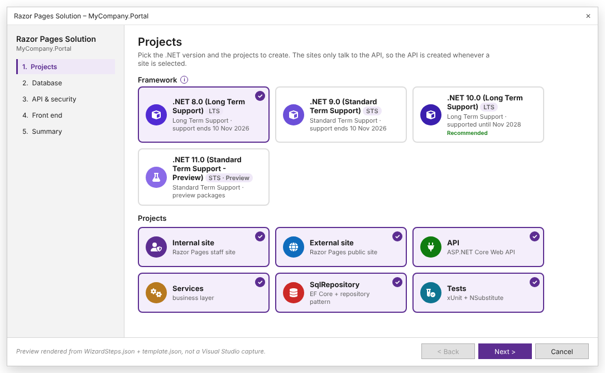 | 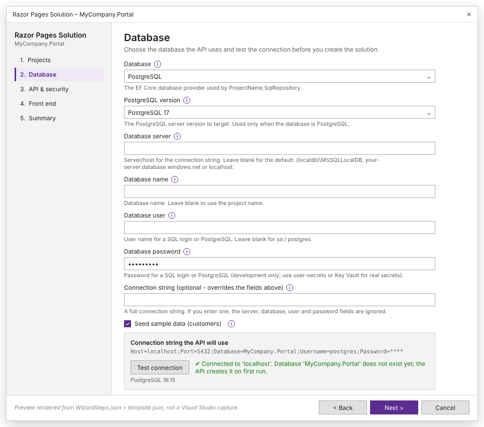 |
| **2. Database: Test connection failed (SQL Server)** | **3. API & security** |
| 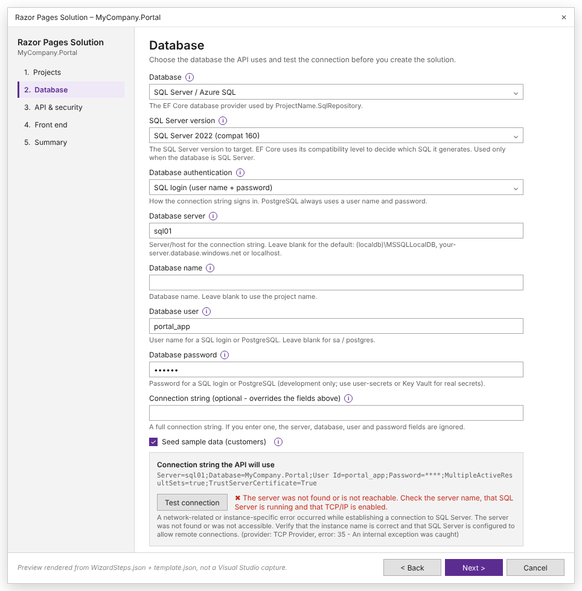 | 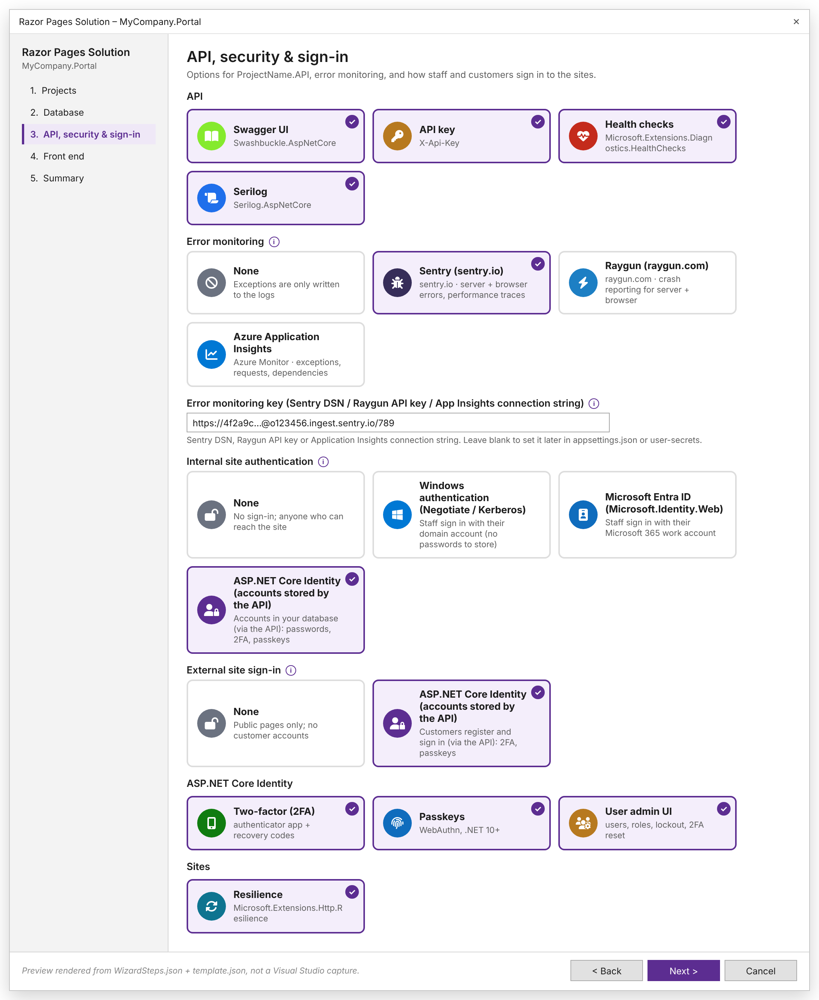 |
| **4. Front end** | **5. Summary** |
| 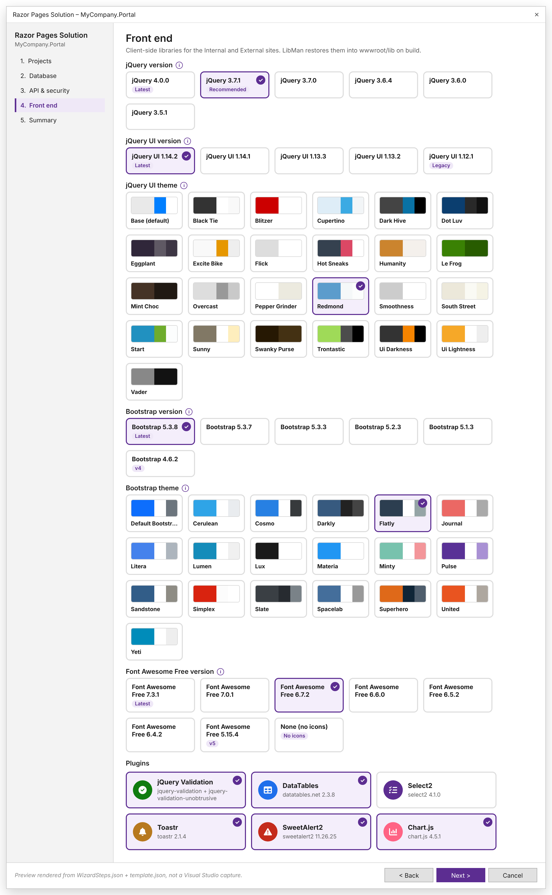 | 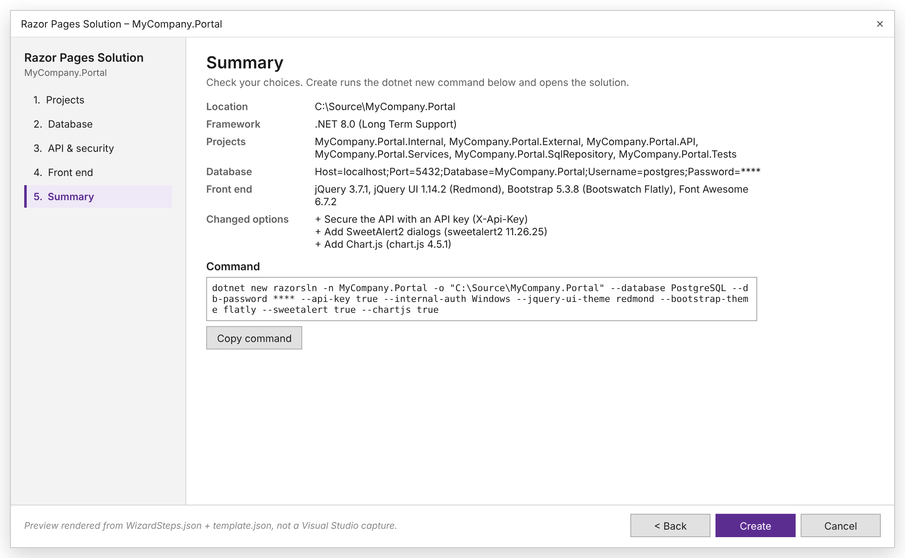 |

<sub>Previews rendered by [`docs/tools/render-wizard-steps.js`](docs/tools/render-wizard-steps.js) from the same `WizardSteps.json` and template metadata the WPF wizard uses (`wizard/src/RazorSolution.Wizard/Tiles.cs` draws the tiles). The previews use Font Awesome icons; the WPF wizard uses the matching Segoe Fluent / MDL2 icons. The Test connection messages are real output from the connection tester (a PostgreSQL 16 server, and an unreachable SQL Server). These are not captures of the WPF window.</sub>

### How Test connection works

- **The connection string tested is the one that gets generated.** The wizard builds it with the same rules the template uses for `ProjectName.API/appsettings.json`. A unit test runs the real `dotnet new` for 7 configurations and checks that they match.
- **No database drivers inside Visual Studio.** The test runs out of process: `dotnet RazorSolution.ConnectionTester.dll --provider SqlServer|PostgreSQL|Sqlite` (shipped in the extension), with the connection string passed on stdin so the password never appears in a process list. It uses `Microsoft.Data.SqlClient` and `Npgsql`, with your timeout.
- **A missing database still counts as success.** If the server and login work but the database doesn't exist yet, the result is "Connected … the API creates it on first run".
- **Readable failure messages.** Failures are translated: server not found or not reachable, login failed, timeout, invalid connection string. The raw driver message is shown underneath.
- **SQLite** checks that the database file's folder is writable.

### Install the extension

1. Get the `.vsix`, either from the **vsix** artifact of the GitHub Actions run, or by building `wizard/RazorSolution.Wizard.sln` in Visual Studio 2022+ (workload *Visual Studio extension development*), which produces `wizard/src/RazorSolution.Vsix/bin/<Configuration>/RazorSolution.Vsix.vsix`.
2. Close Visual Studio and double-click the `.vsix`. Supported targets are Visual Studio 2022 and 2026, on x64 and Arm64.
3. **File → New → Project** → **Razor Pages Solution (Wizard)**, enter the name and location, then **Next** to open the wizard.

The extension contains the template package. If `dotnet new razorsln` isn't installed yet, the wizard installs it the first time you click **Create**. The single-page template (**Razor Pages Solution**) is still available too.

| Project | Purpose |
| --- | --- |
| `wizard/src/RazorSolution.Wizard.Core` | netstandard2.0: reads `template.json` / `ide.host.json` / `dotnetcli.host.json` (embedded at build) and `WizardSteps.json`. It handles step and field visibility, connection strings, the `dotnet new` command line, and running the tester and generator. |
| `wizard/src/RazorSolution.Wizard` | .NET Framework 4.8: the WPF wizard window (built in code, no XAML) and the `IWizard` that New Project calls. |
| `wizard/src/RazorSolution.ConnectionTester` | .NET 8 console app used by **Test connection**. |
| `wizard/src/RazorSolution.Vsix` | The VSIX: the New Project entry (`.vstemplate`), the wizard assemblies, the tester and the template `.nupkg`. |
| `wizard/tests/RazorSolution.Wizard.Tests` | xUnit tests: metadata, visibility rules, command line and quoting, connection strings against real `dotnet new` output, and the tester process. Set `WIZARD_TEST_POSTGRES` to also test against a live PostgreSQL. |

Because the wizard reads the template's own metadata, a new option or version added to `template.json` / `ide.host.json` appears in the wizard automatically. To show it on a specific page, add its id to `WizardSteps.json` (a test fails if any visible option is missing from the wizard). Tile icons, badges, notes and swatches live in the `tiles` section of the same file. Run `node configurator/build-data.js` afterwards to refresh the web configurator.

---

## Web configurator (browser)

`configurator/index.html` is the same wizard in a browser, for people who use Rider, VS Code or the command line, or who want to send a colleague a link:
- the same steps, tiles, badges and theme swatches as the Visual Studio wizard;
- a live preview of the connection string;
- at the end, the `dotnet new razorsln …` command and a script that installs the template first, each with **Copy**, for PowerShell, bash/zsh or cmd.

The browser can't open database connections. Instead, the Database step gives you a ready-to-paste test command: Windows PowerShell's built-in `System.Data.SqlClient` for SQL Server, or `psql` for PostgreSQL.

| Projects | Database |
| --- | --- |
| 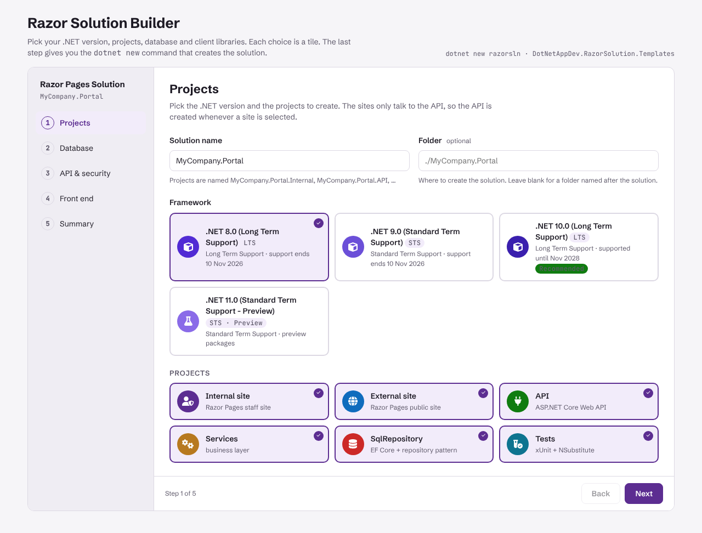 | 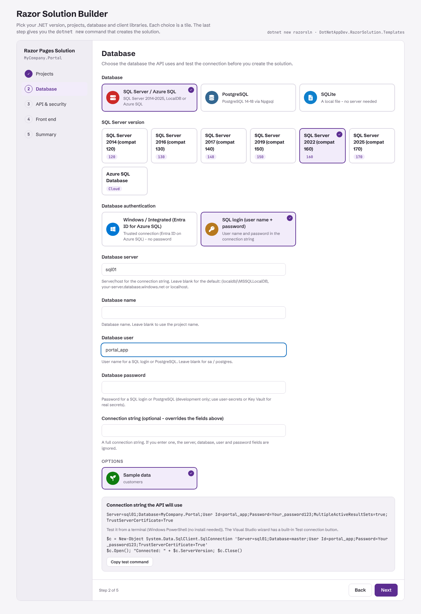 |
| **API & security** | **Front end** |
| 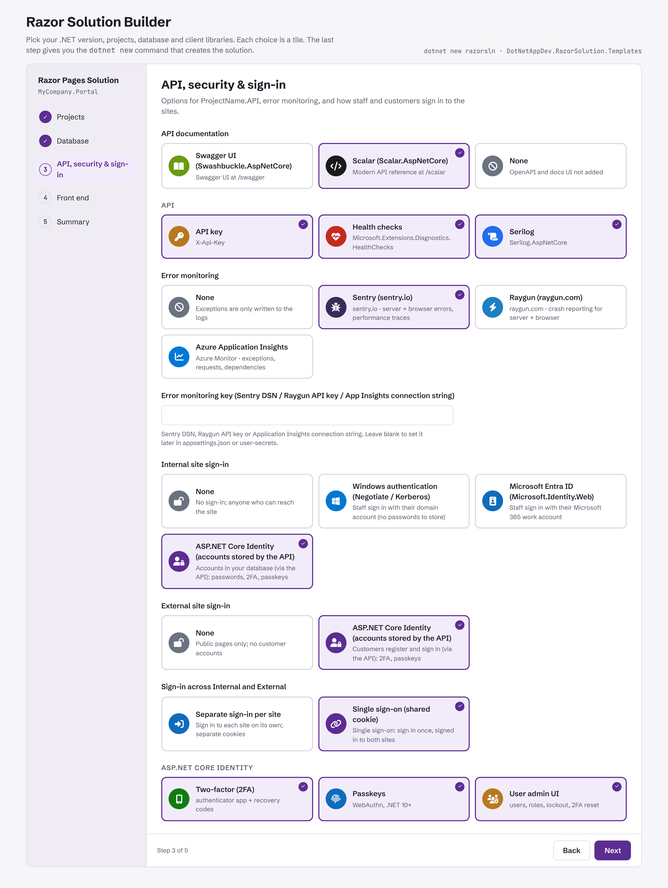 | 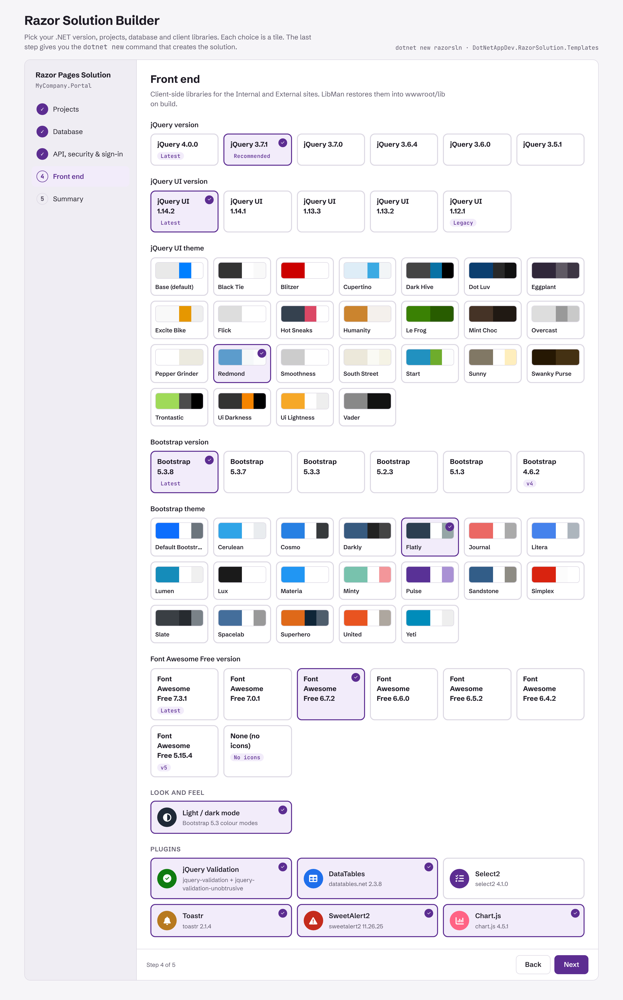 |
| **Summary** | **Phone, dark theme** |
| 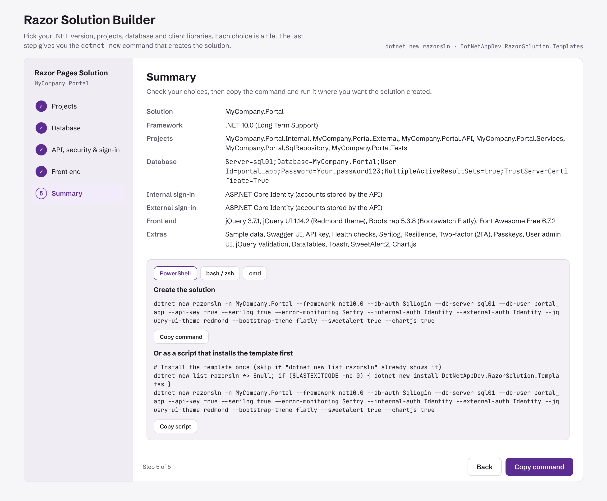 | 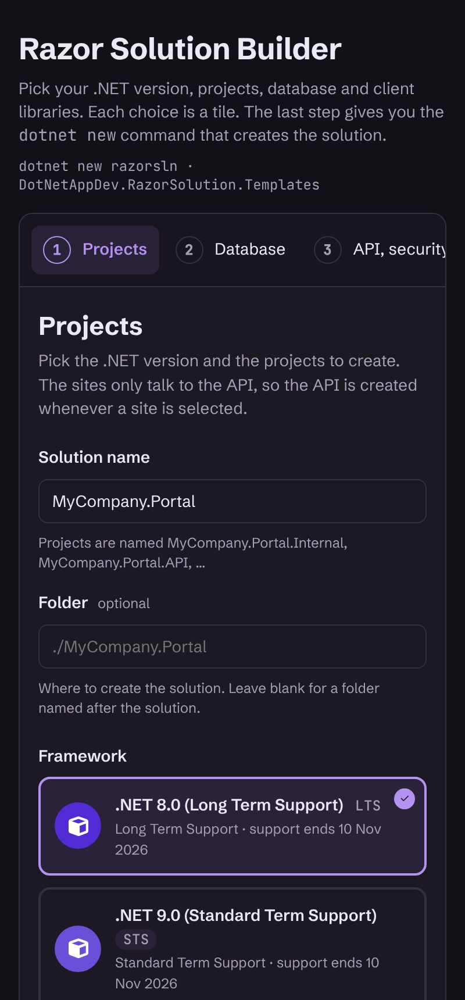 |

You can run it three ways:
- **Locally:** open `configurator/index.html` in a browser. No server is needed.
- **GitHub Pages:** `.github/workflows/configurator-pages.yml` publishes it. Enable it once under **Settings → Pages → Source: GitHub Actions**.
- **Any static host:** copy the `configurator` folder.

Its options come from `configurator/wizard-data.js`, which `node configurator/build-data.js` generates from the template's `template.json` / `ide.host.json` / `dotnetcli.host.json` and `WizardSteps.json`. CI fails if that file is out of date, so the browser, the Visual Studio wizard and `dotnet new` always offer the same options. The page remembers your last choices in the browser, but never the password.

---

## What you get

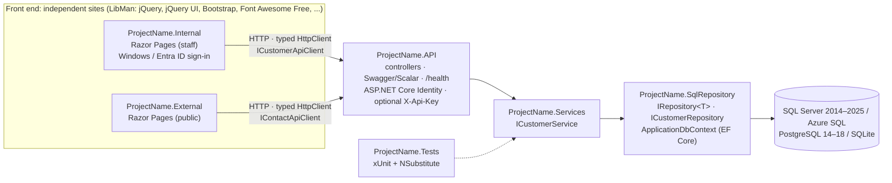

| Project | What it contains |
| --- | --- |
| **ProjectName.Internal** | Staff site with a dashboard (API status, front-end stack, optional Chart.js chart). The Customers page has DataTables, jQuery UI autocomplete, and delete with a SweetAlert2 confirmation. The Create form uses jQuery Validation. Optional Windows or Entra ID sign-in. Calls the API only. |
| **ProjectName.External** | Public site: home page, and a contact form with a jQuery UI date picker and a Select2 topic picker that posts to the API. Calls the API only. |
| **ProjectName.API** | Controllers (`api/customers`, `api/contact-requests`, `api/status`), Swagger UI or Scalar, optional ASP.NET Core Identity (`/api/account/*`, passkeys, `/api/admin/*`), problem details, `/health` with a database check, an optional `X-Api-Key` check, and optional Sentry / Raygun / Application Insights error monitoring. The **only** project that touches the data layer. |
| **ProjectName.Services** | Business logic behind interfaces (`ICustomerService` → `CustomerService`) and DTOs. |
| **ProjectName.SqlRepository** | EF Core: `ApplicationDbContext`, entities, `IEntityTypeConfiguration<T>`, generic `IRepository<T>` / `Repository<T>`, `ICustomerRepository` / `CustomerRepository`, a design-time factory for migrations, and an optional seeder. |
| **ProjectName.Tests** | xUnit + NSubstitute tests for the services. The repositories are faked through their interfaces, so no database is needed. |

Also in every solution:

- **Central Package Management.** Every NuGet version is set in `Directory.Packages.props`. EF Core, Npgsql, Serilog and resilience package versions match the framework you pick.
- **Shared build settings** in `Directory.Build.props`.
- **A README in the generated solution** that covers the options you picked: how to run it, add API clients and entities, use migrations and LibMan, and the security and operations features.

### The generated sites

The screenshots below use the Flatly Bootswatch theme, the Redmond jQuery UI theme, and DataTables, SweetAlert2, Toastr, Select2 and Chart.js.

| Internal – dashboard | Internal – customers with DataTables |
| --- | --- |
| 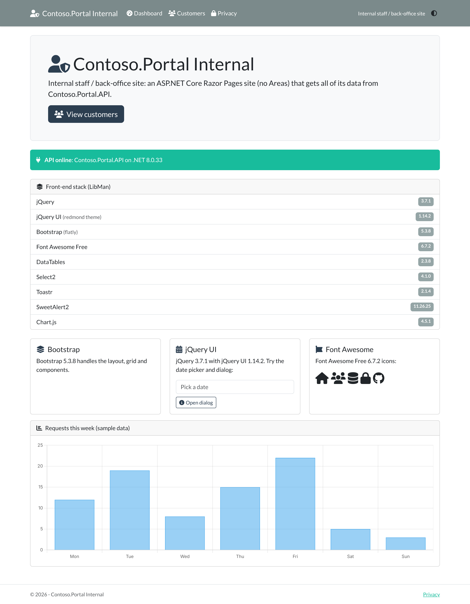 | 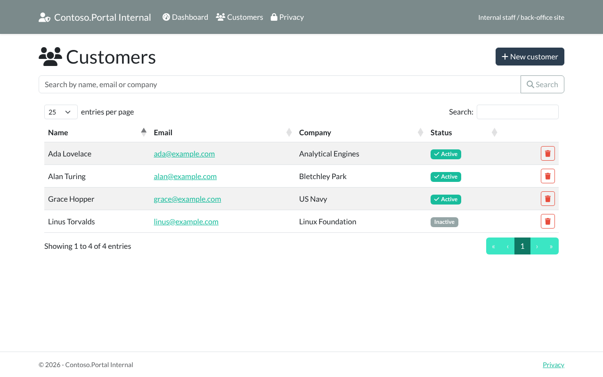 |
| **SweetAlert2 confirm → API `DELETE`** | **Toastr notification** |
| 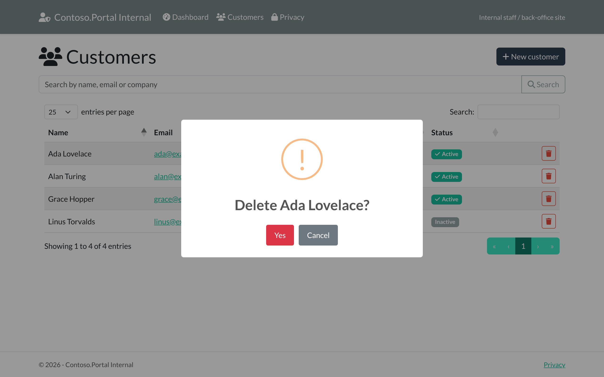 | 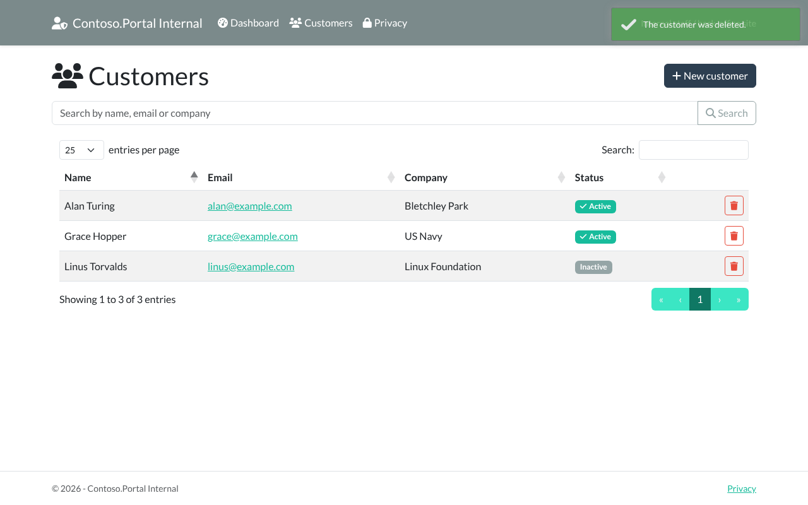 |
| **API validation (409 duplicate email) on the form** | **External – contact form with Select2** |
| 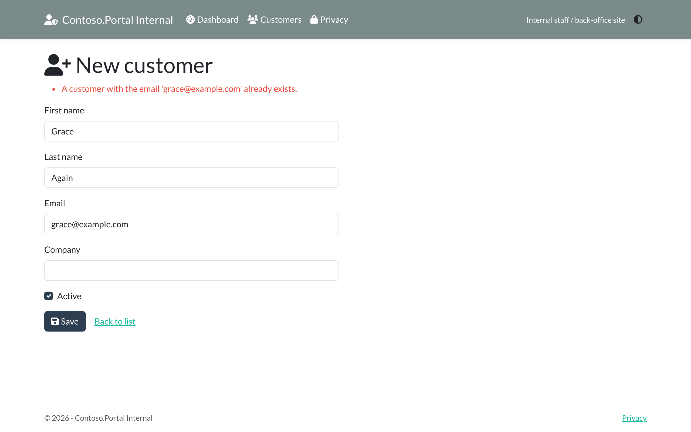 | 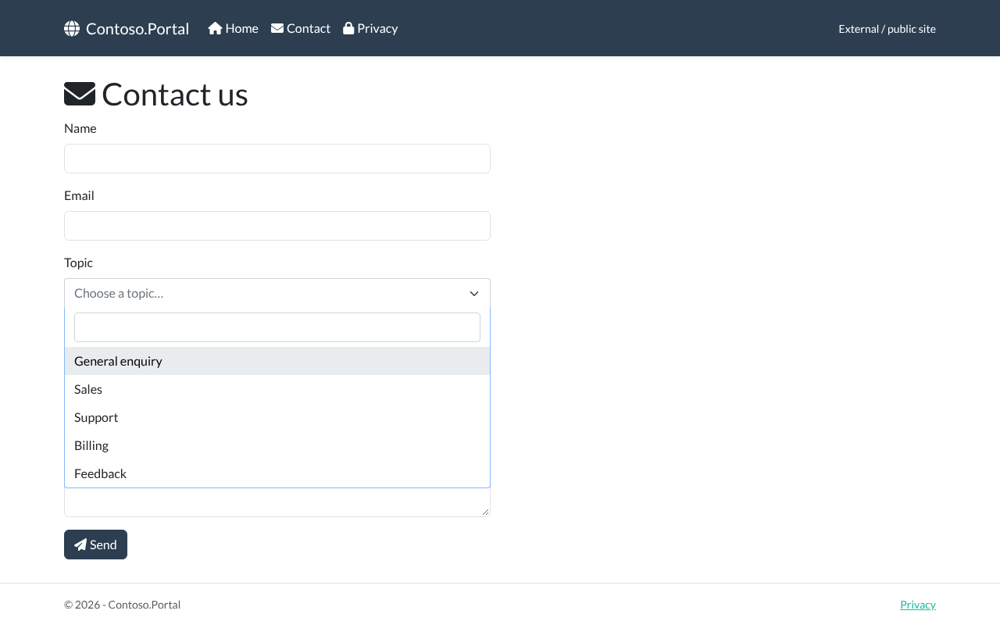 |
| **External – home page, jQuery UI date picker (Redmond)** | **API – Swagger UI** |
| 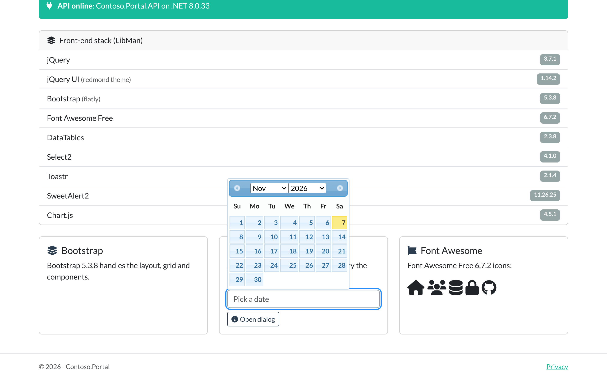 | 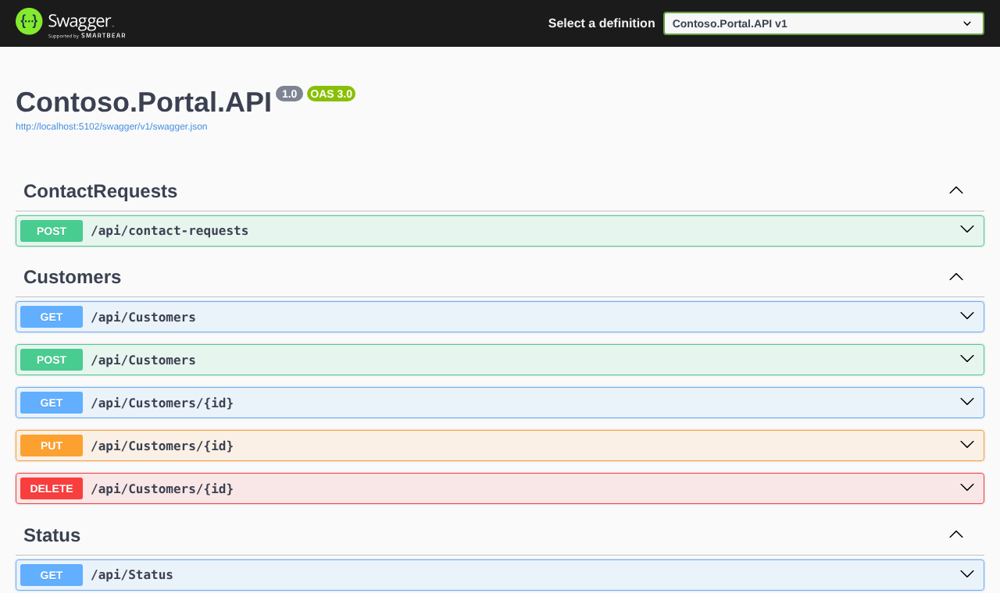 |
| **API – Scalar** | |
| 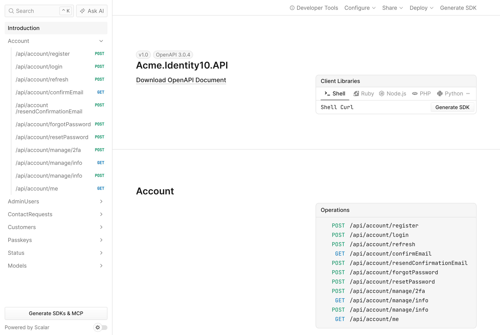 | |

---

## Prerequisites

| Need | Version |
| --- | --- |
| .NET SDK | **8.0** or later. To target .NET 9, 10 or 11, install that SDK; installing the newest SDK is enough to build every target. |
| Visual Studio (optional) | **Visual Studio 2022 17.3 or later** (or Visual Studio 2026), with the **ASP.NET and web development** workload. Older versions don't show the template's options. JetBrains Rider 2024+ also shows them. |
| Database (optional) | SQL Server LocalDB (installed with Visual Studio), SQL Server 2014–2025, Azure SQL, PostgreSQL 14–18 or nothing at all (SQLite). |

---

## Install the template

A template installed with `dotnet new install` appears in **both** the command line and Visual Studio's **New Project** dialog. Install it once per machine.

### Option A – NuGet package built from this repo (recommended)

```powershell
.\build\install-template.ps1      # Windows
```

```bash
./build/install-template.sh       # macOS / Linux
```

The scripts run `dotnet pack` into `artifacts/`, then `dotnet new install` the `.nupkg`. To do it by hand:

```bash
dotnet pack DotNetAppDev.RazorSolution.Templates.csproj -c Release -o artifacts
dotnet new install artifacts/DotNetAppDev.RazorSolution.Templates.1.0.0.nupkg
```

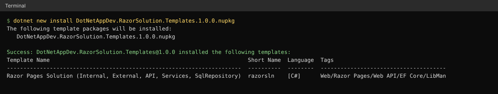

Each CI run also uploads the `.nupkg` as the **template-package** artifact.

### Option B – from your team's NuGet feed (Azure Artifacts, GitHub Packages, nuget.org)

```bash
dotnet nuget push artifacts/DotNetAppDev.RazorSolution.Templates.1.0.0.nupkg --source <your-feed> --api-key <key>

# everyone else:
dotnet new install DotNetAppDev.RazorSolution.Templates --add-source <your-feed-url>
```

### Option C – from the source folder (when you're changing the template)

```bash
dotnet new install ./templates/RazorSolution
```

### Check

```bash
dotnet new list razorsln
```

---

## Create a solution in Visual Studio

1. Install the template (above), then **restart Visual Studio**.
2. **File → New → Project…**, search for **Razor Pages Solution** (or filter **C#** / **Web**), then click **Next**.
3. Enter the solution name (for example `MyCompany.Portal`). Projects are named `MyCompany.Portal.Internal`, `.API` and so on. Click **Next**.
4. On **Additional information**, work down the page:
   - **Framework**: .NET 8 (LTS), 9 (STS), 10 (LTS) or 11 (STS preview).
   - **Projects**: tick Internal, External, API, Services, SqlRepository and Tests. The API is always created when a site is ticked. Services also adds SqlRepository.
   - **Database**: pick the provider, then the SQL Server or PostgreSQL version and the authentication type. Leave server, name, user and password blank for local defaults, or paste a full connection string. Untick **Seed sample data** if you don't want the demo customers.
   - **API**: Swagger UI or Scalar, API key, health checks, Serilog and error monitoring.
   - **Sign-in**:
     - **Internal site:** None, Windows (Negotiate), Microsoft Entra ID, or ASP.NET Core Identity. The Entra tenant and client IDs are optional and can be set later.
     - **External site:** None or ASP.NET Core Identity.
     - **When both sites use Identity:** choose separate sign-in per site, or single sign-on.
     - **Identity extras:** two-factor, passkeys (.NET 10+) and the user admin UI.
   - **Front end**: jQuery, jQuery UI and its theme, Bootstrap and its Bootswatch theme, Font Awesome Free, and the plugin checkboxes.
5. Click **Create**, then [set the startup projects](#run-the-generated-solution).

---

## Create a solution from the command line

```bash
dotnet new razorsln -n MyCompany.Portal
```

That uses every default: .NET 8; Internal, External, API, Services, SqlRepository and Tests; SQL Server 2022 on LocalDB with Windows authentication; jQuery 3.7.1, jQuery UI 1.14.2 (base), Bootstrap 5.3.8, Font Awesome Free 6.7.2, jQuery Validation, DataTables and Toastr; Swagger, health checks and resilience.

```bash
# Staff-only portal on .NET 10 with Windows sign-in, Serilog and an API key
dotnet new razorsln -n MyCompany.Backoffice -f net10.0 --external false \
    --internal-auth Windows --serilog --api-key --sweetalert --chartjs

# PostgreSQL 17, Flatly + Redmond themes, Select2
dotnet new razorsln -n MyCompany.Portal --database PostgreSQL --postgres-version 17 \
    --db-user portal --db-password "Dev_pass1" --bootstrap-theme flatly --jquery-ui-theme redmond --select2

# SQL Server 2019 with a SQL login, Entra ID sign-in for the Internal site
dotnet new razorsln -n MyCompany.Portal --sql-version SqlServer2019 --db-auth SqlLogin \
    --db-server "SQL01\APPS" --db-name Portal --db-user portal_app --db-password "S3cret!" \
    --internal-auth EntraId --entra-tenant-id <tenant-guid> --entra-client-id <client-guid>

# Sentry for the API, both sites and browser JavaScript errors
dotnet new razorsln -n MyCompany.Portal --error-monitoring Sentry \
    --error-monitoring-key "https://<key>@o123456.ingest.sentry.io/<project>"

# Raygun, or Azure Application Insights
dotnet new razorsln -n MyCompany.Portal --error-monitoring Raygun --error-monitoring-key "<raygun api key>"
dotnet new razorsln -n MyCompany.Portal --error-monitoring ApplicationInsights

# Older front-end stack
dotnet new razorsln -n MyCompany.Legacy --bootstrap 4.6.2 --jquery 3.5.1 --jquery-ui 1.12.1 --fontawesome 5.15.4

# ASP.NET Core Identity on both sites with single sign-on, 2FA, passkeys and the admin UI; Scalar for the API
dotnet new razorsln -n MyCompany.Portal -f net10.0 --internal-auth Identity --external-auth Identity \
    --identity-sign-in Shared --identity-2fa --identity-passkeys --identity-admin --api-docs Scalar

# API + data layer only, no sites
dotnet new razorsln -n MyCompany.Api --internal false --external false

# See what would be created
dotnet new razorsln -n MyCompany.Portal --dry-run
```

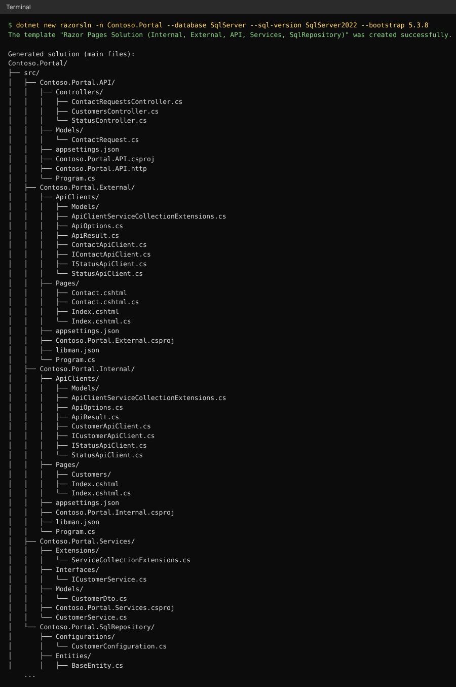

<details>
<summary><code>dotnet new razorsln --help</code></summary>

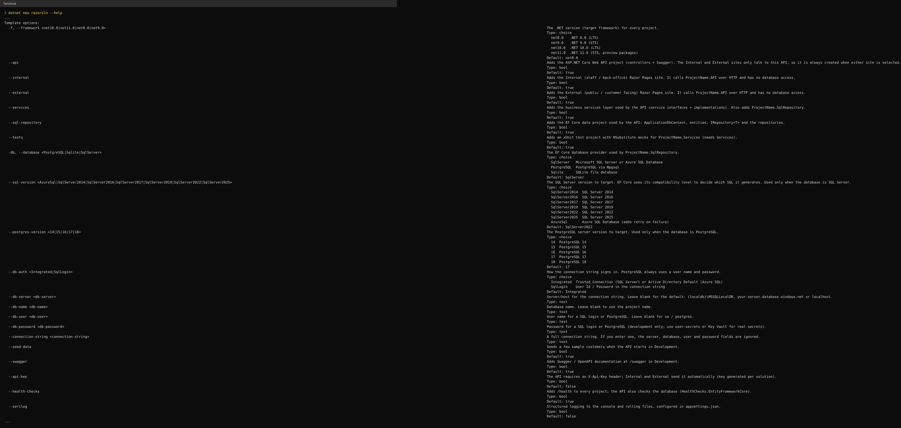

</details>

---

## All options

### Projects

| Option | CLI | Default |
| --- | --- | --- |
| .NET version | `-f`, `--framework` | **`net8.0`** (LTS). Also `net9.0` (STS), `net10.0` (LTS), `net11.0` (STS, preview) |
| Create ProjectName.Internal | `--internal` | **true** |
| Create ProjectName.External | `--external` | **true** |
| Create ProjectName.API | `--api` | **true** (always created when a site is selected) |
| Create ProjectName.Services | `--services` | **true** (also adds SqlRepository) |
| Create ProjectName.SqlRepository | `--sql-repository` | **true** |
| Create ProjectName.Tests (xUnit + NSubstitute) | `--tests` | **true** (needs Services) |

### Database

| Option | CLI | Values (default **bold**) |
| --- | --- | --- |
| Database | `--database` | **`SqlServer`**, `PostgreSQL`, `Sqlite` |
| SQL Server version | `--sql-version` | `SqlServer2014` (120), `SqlServer2016` (130), `SqlServer2017` (140), `SqlServer2019` (150), **`SqlServer2022`** (160), `SqlServer2025` (170), `AzureSql` (adds retry-on-failure) |
| PostgreSQL version | `--postgres-version` | `14`, `15`, `16`, **`17`**, `18` |
| Database authentication | `--db-auth` | **`Integrated`** (Windows; Entra ID on Azure SQL), `SqlLogin` |
| Database server / name | `--db-server`, `--db-name` | blank → `(localdb)\MSSQLLocalDB` / `your-server.database.windows.net` / `localhost`; the solution name |
| Database user / password | `--db-user`, `--db-password` | blank → `sa` or `postgres` / `Your_password123` |
| Connection string | `--connection-string` | overrides the four fields above |
| Seed sample data | `--seed-data` | **true** |

### API, security and operations

| Option | CLI | Package | Default |
| --- | --- | --- | --- |
| API documentation | `--api-docs` | `Swagger` (Swashbuckle.AspNetCore, /swagger), `Scalar` (Scalar.AspNetCore, /scalar), `None` | **Swagger** |
| API key (`X-Api-Key`) | `--api-key` | (none; generated key) | false |
| Health checks (`/health`) | `--health-checks` | Microsoft.Extensions.Diagnostics.HealthChecks(.EntityFrameworkCore) | **true** |
| Serilog | `--serilog` | Serilog.AspNetCore | false |
| Error monitoring | `--error-monitoring` | `None`, `Sentry` (Sentry.AspNetCore + Sentry browser SDK), `Raygun` (Mindscape.Raygun4Net.AspNetCore + raygun4js), `ApplicationInsights` (Microsoft.ApplicationInsights.AspNetCore) | **None** |
| Error monitoring key | `--error-monitoring-key` | Sentry DSN / Raygun API key / Application Insights connection string | blank (set later) |
| Internal site sign-in | `--internal-auth` | `None`, `Windows` (Microsoft.AspNetCore.Authentication.Negotiate), `EntraId` (Microsoft.Identity.Web), `Identity` (ASP.NET Core Identity in the API) | **None** |
| External site sign-in | `--external-auth` | `None`, `Identity` (ASP.NET Core Identity in the API, self-registration) | **None** |
| Sign-in across both sites | `--identity-sign-in` | `Separate` (a cookie per site), `Shared` (single sign-on: one cookie, shared Data Protection keys). Only when both sites use Identity | **Separate** |
| Two-factor (Identity) | `--identity-2fa` | authenticator app (QR code) + recovery codes | **true** |
| Passkeys (Identity) | `--identity-passkeys` | WebAuthn passkeys; needs .NET 10 or later | **true** |
| User admin UI (Identity) | `--identity-admin` | Internal site: users, roles, lock/unlock, reset 2FA, remove passkeys, delete | **true** |
| Entra ID tenant / client ID | `--entra-tenant-id`, `--entra-client-id` | | blank (placeholder GUIDs) |
| Resilience for API clients | `--resilience` | Microsoft.Extensions.Http.Resilience | **true** |

### Front end (LibMan)

| Option | CLI | Values (default **bold**) |
| --- | --- | --- |
| jQuery | `--jquery` | `4.0.0`, **`3.7.1`**, `3.7.0`, `3.6.4`, `3.6.0`, `3.5.1` |
| jQuery UI | `--jquery-ui` | **`1.14.2`**, `1.14.1`, `1.13.3`, `1.13.2`, `1.12.1` |
| jQuery UI theme | `--jquery-ui-theme` | **`base`**, `black-tie`, `blitzer`, `cupertino`, `dark-hive`, `dot-luv`, `eggplant`, `excite-bike`, `flick`, `hot-sneaks`, `humanity`, `le-frog`, `mint-choc`, `overcast`, `pepper-grinder`, `redmond`, `smoothness`, `south-street`, `start`, `sunny`, `swanky-purse`, `trontastic`, `ui-darkness`, `ui-lightness`, `vader` |
| Bootstrap | `--bootstrap` | **`5.3.8`**, `5.3.7`, `5.3.3`, `5.2.3`, `5.1.3`, `4.6.2` (the markup adapts to v4) |
| Bootstrap theme | `--bootstrap-theme` | **`default`**, or Bootswatch `cerulean`, `cosmo`, `darkly`, `flatly`, `journal`, `litera`, `lumen`, `lux`, `materia`, `minty`, `pulse`, `sandstone`, `simplex`, `slate`, `spacelab`, `superhero`, `united`, `yeti` |
| Font Awesome **Free** | `--fontawesome` | `7.3.1`, `7.0.1`, **`6.7.2`**, `6.6.0`, `6.5.2`, `6.4.2`, `5.15.4`, `none`. Always the free `@fortawesome/fontawesome-free` package; Pro is never offered |
| jQuery Validation | `--jquery-validation` | **true** |
| DataTables 2.3.8 | `--datatables` | **true** |
| Select2 4.1.0 | `--select2` | false |
| Toastr 2.1.4 | `--toastr` | **true** |
| SweetAlert2 11.26.25 | `--sweetalert` | false |
| Chart.js 4.5.1 | `--chartjs` | false |

Connection-string values are escaped for JSON and C#. The connection string goes only into **`ProjectName.API/appsettings.json`** (plus `DatabaseDefaults.cs`, which the EF tools use). The sites never have one.

---

## Run the generated solution

The sites need the API.

**Visual Studio:**
1. Right-click the solution → **Configure Startup Projects…** → **Multiple startup projects**.
2. Set the **API**, **Internal** and **External** projects to **Start**, with the API first.
3. Press F5. The API opens on `/swagger` (or `/scalar` with Scalar).

**Command line:**

```bash
dotnet dev-certs https --trust      # once per machine
dotnet run --project src/MyCompany.Portal.API --launch-profile https
dotnet run --project src/MyCompany.Portal.Internal --launch-profile https
dotnet run --project src/MyCompany.Portal.External --launch-profile https
dotnet test                         # if you created ProjectName.Tests
```

How the sites find the API:
- **Development:** `Api:BaseUrl` in each site's `appsettings.Development.json` points at the API's https port.
- **`http` launch profile:** sets `Api__BaseUrl` to the API's http port.
- **Production:** set `Api:BaseUrl` in configuration.

If the API is down, the sites show an **API offline** message instead of failing.

---

## Client-side libraries (LibMan)

Each site has its own `libman.json`. Packages come from **jsDelivr** (npm), and jQuery UI comes from **cdnjs**, so all the ThemeRoller themes are available. Each package is restored into `wwwroot/lib`:

- **On every build**, by the `Microsoft.Web.LibraryManager.Build` package. This works in Visual Studio, `dotnet build` and CI. `wwwroot/lib` is git-ignored.
- **In Visual Studio:** saving `libman.json` restores straight away. Right-click → **Restore Client-Side Libraries**, or **Add → Client-Side Library…** on the project.
- **CLI:** `dotnet tool install -g Microsoft.Web.LibraryManager.Cli`, then `libman restore`.

To upgrade a library, change the `@version` in both sites' `libman.json`. `Directory.Build.targets` retries a restore that collides with the other site's restore during a parallel build.

---

## Sign-in with ASP.NET Core Identity

Choose **ASP.NET Core Identity** for the Internal site, the External site, or both. Identity lives in the **API**, and the sites still never touch the database:

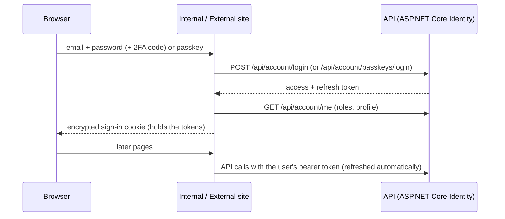

| Feature | How |
| --- | --- |
| Accounts, roles, lockout | ASP.NET Core Identity (`MapIdentityApi`) in the API, stored by `ApplicationDbContext` (SqlRepository). Choosing Identity adds the data layer automatically |
| Development admin | `admin@example.com` / `Admin!Dev2026` with the Admin role, from `Identity:SeedAdmin` in the API's `appsettings.Development.json` |
| Internal = staff only | Internal requires the **Staff** or **Admin** role. Customers who register on External get "Access denied" there. The admin UI gives new users the Staff role by default |
| Two-factor | Authenticator app (QR code + key) and recovery codes. Sign-in asks for the code; lost device → recovery code |
| Passkeys (.NET 10+) | Windows Hello, Touch ID, phones and security keys through .NET 10's `IPasskeyHandler`. The WebAuthn state stays on the server. The API accepts the sites' origins from `Identity:Passkeys:AllowedOrigins`, and `ServerDomain` is the sites' shared domain |
| User admin UI | Internal → **Users**: create, set roles, lock/unlock, reset two-factor, remove passkeys, delete (Admin role) |
| Separate sign-in | Each site has its own cookie: sign in to each site on its own |
| Single sign-on | Both sites use one cookie name and shared Data Protection keys, so signing in or out on one site does the same on the other. In Development the keys are kept in `.keys/` at the solution root. In production, set `Authentication:SharedKeysFolder` (storage both sites share) and `Authentication:CookieDomain` (for example `.example.com`), and host both sites under that domain |

| Sign in (password or passkey) | Two-factor code at sign-in |
| --- | --- |
| 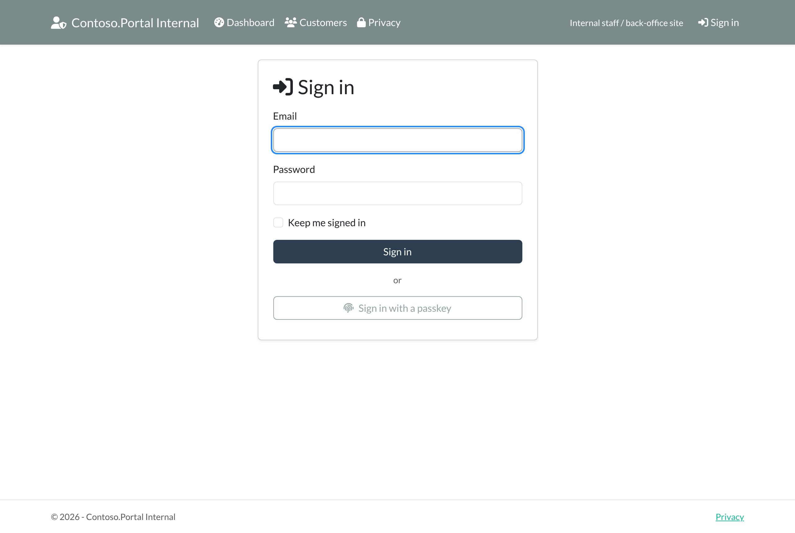 | 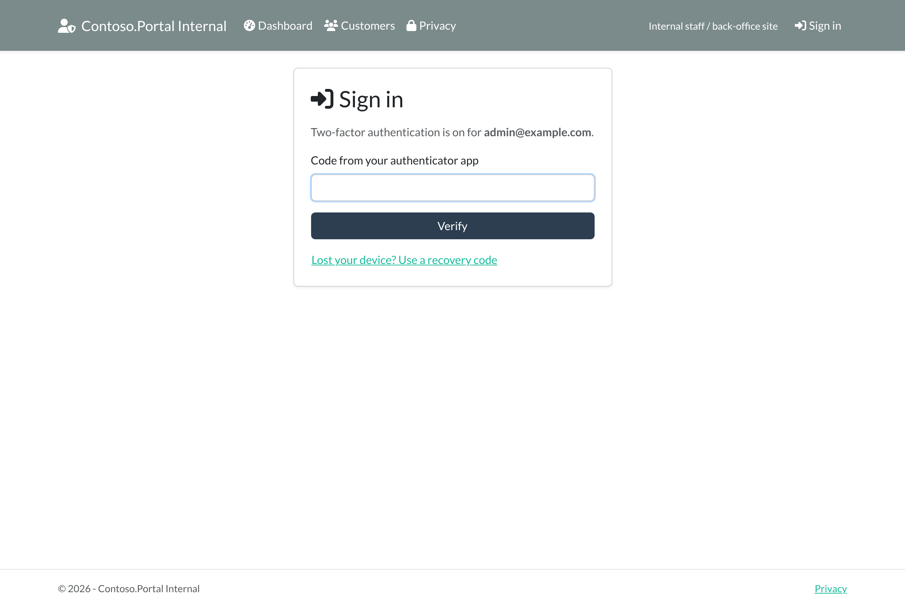 |
| **Two-factor setup (QR code)** | **Recovery codes** |
| 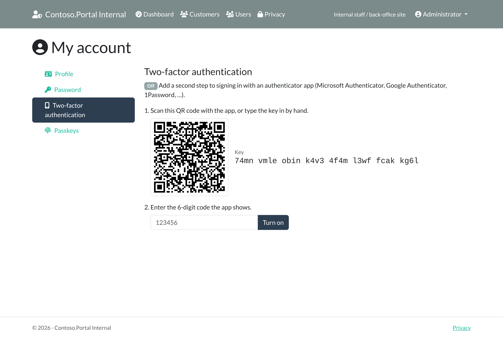 | 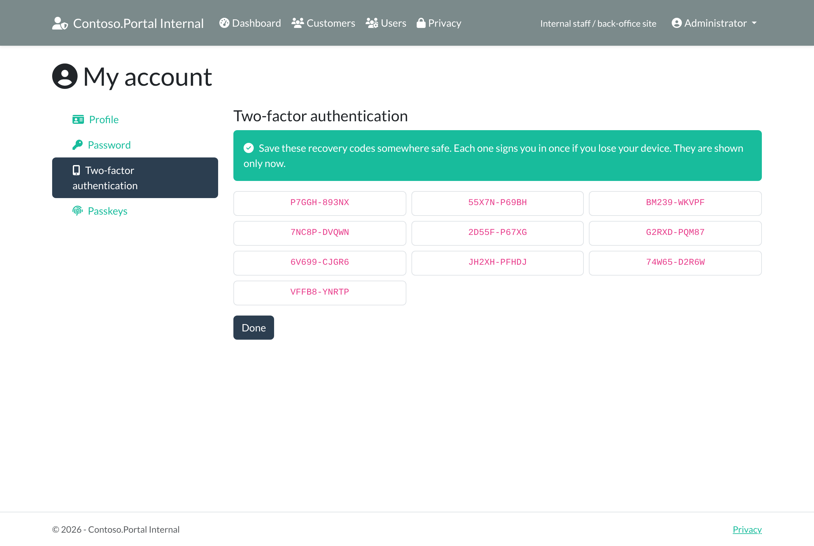 |
| **Passkeys** | **Admin – users** |
| 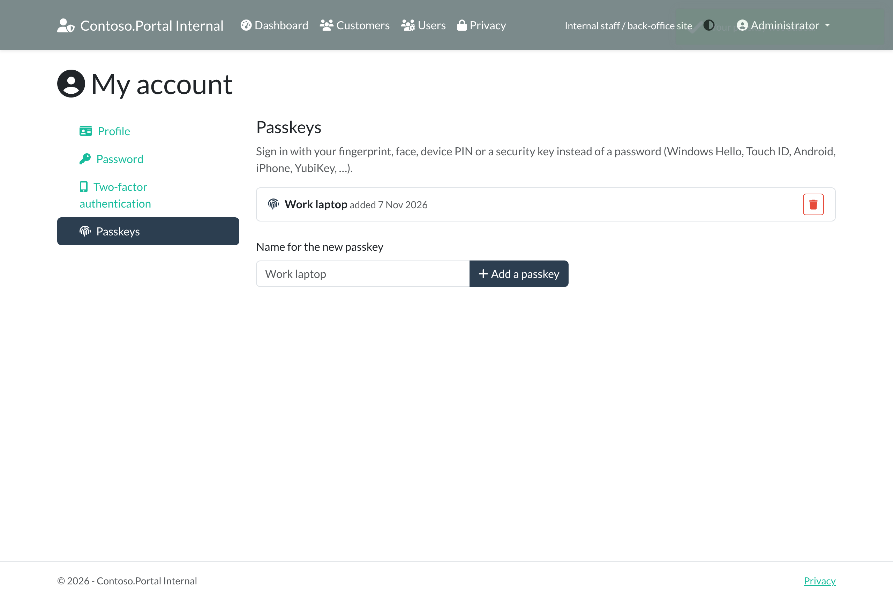 | 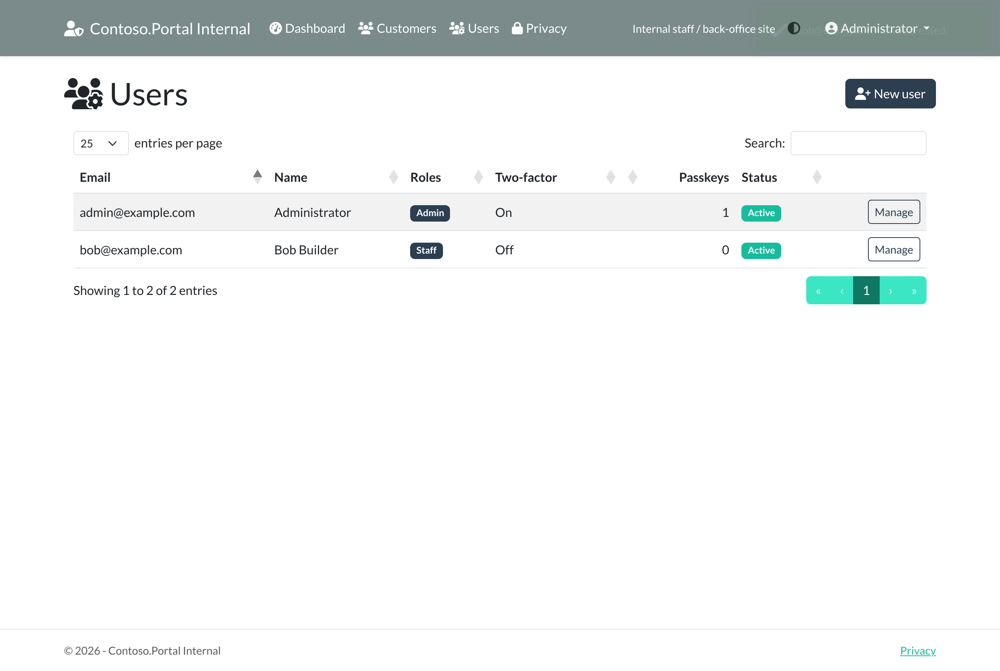 |
| **Admin – edit user (locked)** | **Customer on the Internal site** |
| 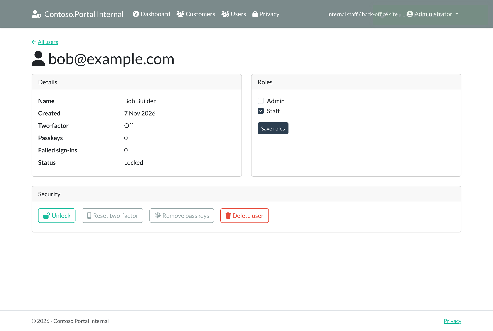 | 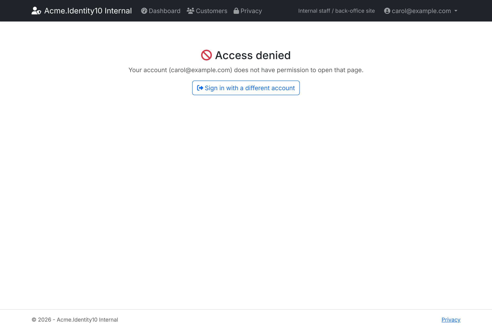 |

All of the above runs in a browser test against a generated .NET 10 solution:
- **Password and two-factor:** password sign-in, turning on two-factor with real authenticator codes, a wrong code being rejected, and a recovery code.
- **Passkeys:** adding a passkey and signing in with it alone, using Chromium's virtual authenticator.
- **Admin:** creating and locking a user, and the locked user being refused.
- **Customers:** registering on External; the customer is refused on Internal.
- **Single sign-on:** signing in on one site, and signing out on the other.

---

## Error monitoring (Sentry, Raygun, Application Insights)

Pick one service in the wizard, or use `--error-monitoring`. The API, the Internal site and the External site are all wired up, and each one can report to its own project.

| Service | What is captured | Where the key goes | When it's off |
| --- | --- | --- | --- |
| **Sentry** (sentry.io) | Unhandled exceptions, `ILogger` errors, sampled performance traces (`TracesSampleRate`), and browser JavaScript errors (the Sentry browser SDK, restored by LibMan) | `Sentry:Dsn` in each `appsettings.json` | Empty `Dsn` |
| **Raygun** (raygun.com) | Unhandled exceptions (Raygun4Net middleware) and browser JavaScript errors (raygun4js) | `RaygunSettings:ApiKey` | Empty `ApiKey` |
| **Azure Application Insights** | Exceptions, requests, dependencies (including the sites' calls to the API) and logs | `ApplicationInsights:ConnectionString`, or the `APPLICATIONINSIGHTS_CONNECTION_STRING` variable | No connection string |

Keep real keys out of source control, for example with `dotnet user-secrets set "Sentry:Dsn" "<dsn>" --project src/MyCompany.Portal.API`.

This was tested against a local stand-in for each service:
- **Sentry:** received the API's logged errors from the .NET SDK, and a page's JavaScript error from the browser SDK.
- **Raygun:** received an unhandled exception from the Internal site.
- **Application Insights:** the solution starts and runs with a connection string set.

---

## Database and EF Core

- In Development, the **API** creates the database on startup. It uses `EnsureCreated` until you add a migration, then switches to `Migrate`. It seeds the demo customers if **Seed sample data** was ticked.
- Migrations come from the SqlRepository project. A design-time factory means no startup project is needed:

  ```bash
  dotnet tool install --global dotnet-ef
  dotnet ef migrations add InitialCreate --project src/MyCompany.Portal.SqlRepository
  dotnet ef database update --project src/MyCompany.Portal.SqlRepository
  ```

  In Visual Studio's Package Manager Console, set **Default project** to `*.SqlRepository`, then run `Add-Migration InitialCreate` and `Update-Database`.
- Keep secrets in user-secrets: `dotnet user-secrets set "ConnectionStrings:DefaultConnection" "<conn>" --project src/MyCompany.Portal.API`

---

## Update or uninstall the template

```bash
# new version: bump <PackageVersion> in the .csproj, pack, then
dotnet new install artifacts/DotNetAppDev.RazorSolution.Templates.1.1.0.nupkg --force
# from a feed
dotnet new update
# remove
dotnet new uninstall DotNetAppDev.RazorSolution.Templates
```

Restart Visual Studio afterwards.

---

## Troubleshooting

| Problem | Fix |
| --- | --- |
| The template is missing in Visual Studio | Check `dotnet new list razorsln`, then restart Visual Studio. You need VS 2022 17.3 or later. On older 2022 builds, enable **Tools → Options → Environment → Preview Features → Show all .NET Core templates in the New project dialog**. |
| The options don't appear in Visual Studio | VS older than 17.3 ignores `ide.host.json`. Update Visual Studio, or use the CLI. |
| "API offline" on a site | Start the API, check `Api:BaseUrl`, and trust the dev certificate (`dotnet dev-certs https --trust`), or use the `http` profiles. |
| A customer can't open the Internal site | That's by design: Internal needs the Staff or Admin role. Give the user the Staff role under **Users**. |
| Passkey prompt fails with a security error | Add the site's exact origin (scheme, host and port) to `Identity:Passkeys:AllowedOrigins` in the API, and set `ServerDomain` to the sites' shared domain. Passkeys need https, except on localhost. |
| Single sign-on doesn't carry over | Both sites need the same `Authentication:SharedKeysFolder` and must be on the same domain (`Authentication:CookieDomain`). |
| 401 from the API | The API key option is on. Check that `Api:ApiKey` (sites) matches `Security:ApiKey` (API). |
| LibMan errors during build | Make sure `cdn.jsdelivr.net` and `cdnjs.cloudflare.com` are reachable. Behind a proxy, set `HTTPS_PROXY`. |
| Internal site keeps asking for a login | Windows auth needs a domain or local Windows account (on IIS, enable Windows Authentication). Entra ID needs real `AzureAd:TenantId` and `ClientId` values, and the redirect URI registered. |
| `Cannot open database` / LocalDB not found | Install SQL Server Express LocalDB, or change `ConnectionStrings:DefaultConnection` in the API. |
| The .NET 11 option fails to restore | It uses preview packages. Install the .NET 11 preview SDK, or pick 8/9/10. |

---

## Working on the template

| Path | What |
| --- | --- |
| `templates/RazorSolution/` | The template content: a source solution named `TemplateApp`, which becomes your solution name. |
| `…/.template.config/template.json` | Parameters, choices, conditional files, and generated values: package versions per framework, SQL compatibility level, escaped connection strings, API key, ports. |
| `…/.template.config/ide.host.json` | The Visual Studio wizard: which options appear, in which order, with which labels and tooltips. |
| `…/.template.config/dotnetcli.host.json` | CLI switch names. |
| `DotNetAppDev.RazorSolution.Templates.csproj` | Packs `templates/**` into the NuGet template package. |
| `tests/test-template.sh` | Creates and builds 12 combinations (every framework, database and auth mode, Bootstrap 4/5, themes, all plugins on and off, API key, Serilog, …) and runs the generated unit tests. |
| `docs/tools/render-wizard-preview.js`, `render-wizard-steps.js` | Regenerate the wizard images in `docs/images` from `template.json` / `ide.host.json` / `WizardSteps.json`. |
| `wizard/` | The multi-step Visual Studio wizard extension (see above). |
| `configurator/` | The browser version of the wizard (`index.html`, generated `wizard-data.js`, `build-data.js`). |
| `.github/workflows/template-tests.yml` | CI: runs the template matrix, builds and tests the wizard (with a PostgreSQL service), and builds the `.vsix` on Windows. |

To add a version to a picker, add a `choices` entry in `template.json`: for example `BootstrapVersion` (a matching Bootswatch version must exist), `JQueryVersion` or `FontAwesomeVersion`. For a new .NET release, add a `Framework` choice and cases to the `EfCoreVersion`, `NpgsqlVersion`, `SwashbuckleVersion`, `SerilogVersion` and `ResilienceVersion` switches. Then run:

```bash
tests/test-template.sh
node docs/tools/render-wizard-preview.js
```
