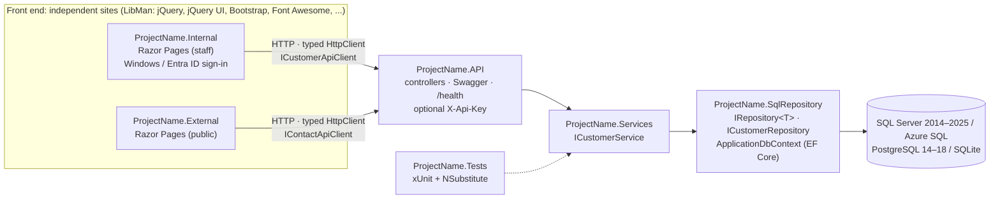

# Razor Pages Solution Template

A `dotnet new` and Visual Studio template that creates an ASP.NET Core solution: **two independent Razor Pages sites** (Internal and External, no Areas) that talk **only to an API layer**, which sits on a Services layer and an EF Core **SqlRepository** (repository pattern).

Like the [Shiny .NET templates](https://github.com/shinyorg/templates), all the choices are made in Visual Studio's **New Project** wizard, or with switches on the command line:

- the .NET version (LTS/STS)
- which projects to create
- the database, its version and the connection string
- authentication
- the jQuery, jQuery UI (and theme), Bootstrap (and Bootswatch theme) and Font Awesome versions
- optional extras: DataTables, Select2, Toastr, SweetAlert2, Chart.js, Serilog, health checks, an API key, resilience and unit tests

Every client library is installed with **LibMan**.

<p align="center"></p>

<sub>Preview of Visual Studio's *Additional information* page for this template. It is rendered from the template's `ide.host.json` / `template.json` by [`docs/tools/render-wizard-preview.js`](docs/tools/render-wizard-preview.js), so it shows the same options, order, labels and defaults. It is not a Visual Studio capture.</sub>

---

## Contents

1. [The New Project wizard](#the-new-project-wizard)
2. [What you get](#what-you-get)
3. [Prerequisites](#prerequisites)
4. [Install the template](#install-the-template)
5. [Create a solution in Visual Studio](#create-a-solution-in-visual-studio)
6. [Create a solution from the command line](#create-a-solution-from-the-command-line)
7. [All options](#all-options)
8. [Run the generated solution](#run-the-generated-solution)
9. [Client-side libraries (LibMan)](#client-side-libraries-libman)
10. [Database and EF Core](#database-and-ef-core)
11. [Update or uninstall the template](#update-or-uninstall-the-template)
12. [Troubleshooting](#troubleshooting)
13. [Working on the template](#working-on-the-template)

---

## The New Project wizard

After you name the solution, Visual Studio shows **Additional information**: one page with every option. Each option has an ⓘ tooltip, and the checkboxes show the NuGet or LibMan package they add.

| .NET version: LTS and STS | Database provider |
| --- | --- |
|  |  |
| **SQL Server version: sets EF Core's compatibility level** | **Internal site authentication** |
|  |  |
| **jQuery** | **jQuery UI** |
|  |  |
| **jQuery UI theme: all 25 ThemeRoller themes** | **Bootstrap** |
|  |  |
| **Bootstrap theme: Bootswatch** | **Font Awesome** |
|  |  |

<details>
<summary>Light theme</summary>


</details>

Visual Studio remembers your choices (checkboxes and versions) for the next solution you create from the template. It does not remember connection details or Entra IDs.

---

## What you get



| Project | What it contains |
| --- | --- |
| **ProjectName.Internal** | Staff site with a dashboard (API status, front-end stack, optional Chart.js chart). The Customers page has DataTables, jQuery UI autocomplete, and delete with a SweetAlert2 confirmation. The Create form uses jQuery Validation. Optional Windows or Entra ID sign-in. Calls the API only. |
| **ProjectName.External** | Public site: home page, and a contact form with a jQuery UI date picker and a Select2 topic picker that posts to the API. Calls the API only. |
| **ProjectName.API** | Controllers (`api/customers`, `api/contact-requests`, `api/status`), Swagger UI, problem details, `/health` with a database check, and an optional `X-Api-Key` check. The **only** project that touches the data layer. |
| **ProjectName.Services** | Business logic behind interfaces (`ICustomerService` → `CustomerService`) and DTOs. |
| **ProjectName.SqlRepository** | EF Core: `ApplicationDbContext`, entities, `IEntityTypeConfiguration<T>`, generic `IRepository<T>` / `Repository<T>`, `ICustomerRepository` / `CustomerRepository`, a design-time factory for migrations, and an optional seeder. |
| **ProjectName.Tests** | xUnit + NSubstitute tests for the services. The repositories are faked through their interfaces, so no database is needed. |

Also in every solution:

- **Central Package Management.** Every NuGet version is set in `Directory.Packages.props`. EF Core, Npgsql, Serilog and resilience package versions match the framework you pick.
- **Shared build settings** in `Directory.Build.props`.
- **A README in the generated solution** that covers the options you picked: how to run it, add API clients and entities, use migrations and LibMan, and the security and operations features.

### The generated sites

The screenshots below use the Flatly Bootswatch theme, the Redmond jQuery UI theme, and DataTables, SweetAlert2, Toastr, Select2 and Chart.js.

| Internal – dashboard | Internal – customers with DataTables |
| --- | --- |
|  |  |
| **SweetAlert2 confirm → API `DELETE`** | **Toastr notification** |
|  |  |
| **API validation (409 duplicate email) on the form** | **External – contact form with Select2** |
|  |  |
| **External – home page, jQuery UI date picker (Redmond)** | **API – Swagger UI** |
|  |  |

---

## Prerequisites

| Need | Version |
| --- | --- |
| .NET SDK | **8.0** or later. To target .NET 9, 10 or 11, install that SDK; installing the newest SDK is enough to build every target. |
| Visual Studio (optional) | **Visual Studio 2022 17.3 or later** (or Visual Studio 2026), with the **ASP.NET and web development** workload. Older versions don't show the template's options. JetBrains Rider 2024+ also shows them. |
| Database (optional) | SQL Server LocalDB (installed with Visual Studio), SQL Server 2014–2025, Azure SQL, PostgreSQL 14–18 or nothing at all (SQLite). |

---

## Install the template

A template installed with `dotnet new install` appears in **both** the command line and Visual Studio's **New Project** dialog. Install it once per machine.

### Option A – NuGet package built from this repo (recommended)

```powershell
.\build\install-template.ps1      # Windows
```

```bash
./build/install-template.sh       # macOS / Linux
```

The scripts run `dotnet pack` into `artifacts/`, then `dotnet new install` the `.nupkg`. To do it by hand:

```bash
dotnet pack DotNetAppDev.RazorSolution.Templates.csproj -c Release -o artifacts
dotnet new install artifacts/DotNetAppDev.RazorSolution.Templates.1.0.0.nupkg
```


Each CI run also uploads the `.nupkg` as the **template-package** artifact.

### Option B – from your team's NuGet feed (Azure Artifacts, GitHub Packages, nuget.org)

```bash
dotnet nuget push artifacts/DotNetAppDev.RazorSolution.Templates.1.0.0.nupkg --source <your-feed> --api-key <key>

# everyone else:
dotnet new install DotNetAppDev.RazorSolution.Templates --add-source <your-feed-url>
```

### Option C – from the source folder (when you're changing the template)

```bash
dotnet new install ./templates/RazorSolution
```

### Check

```bash
dotnet new list razorsln
```

---

## Create a solution in Visual Studio

1. Install the template (above), then **restart Visual Studio**.
2. **File → New → Project…**, search for **Razor Pages Solution** (or filter **C#** / **Web**), then click **Next**.
3. Enter the solution name (for example `MyCompany.Portal`). Projects are named `MyCompany.Portal.Internal`, `.API` and so on. Click **Next**.
4. On **Additional information**, work down the page:
   - **Framework**: .NET 8 (LTS), 9 (STS), 10 (LTS) or 11 (STS preview).
   - **Projects**: tick Internal, External, API, Services, SqlRepository and Tests. The API is always created when a site is ticked. Services also adds SqlRepository.
   - **Database**: pick the provider, then the SQL Server or PostgreSQL version and the authentication type. Leave server, name, user and password blank for local defaults, or paste a full connection string. Untick **Seed sample data** if you don't want the demo customers.
   - **API**: Swagger, API key, health checks and Serilog.
   - **Internal site authentication**: None, Windows (Negotiate) or Microsoft Entra ID. The tenant and client IDs are optional and can be set later.
   - **Front end**: jQuery, jQuery UI and its theme, Bootstrap and its Bootswatch theme, Font Awesome, and the plugin checkboxes.
5. Click **Create**, then [set the startup projects](#run-the-generated-solution).

---

## Create a solution from the command line

```bash
dotnet new razorsln -n MyCompany.Portal
```

That uses every default: .NET 8; Internal, External, API, Services, SqlRepository and Tests; SQL Server 2022 on LocalDB with Windows authentication; jQuery 3.7.1, jQuery UI 1.14.2 (base), Bootstrap 5.3.8, Font Awesome 6.7.2, jQuery Validation, DataTables and Toastr; Swagger, health checks and resilience.

```bash
# Staff-only portal on .NET 10 with Windows sign-in, Serilog and an API key
dotnet new razorsln -n MyCompany.Backoffice -f net10.0 --external false \
    --internal-auth Windows --serilog --api-key --sweetalert --chartjs

# PostgreSQL 17, Flatly + Redmond themes, Select2
dotnet new razorsln -n MyCompany.Portal --database PostgreSQL --postgres-version 17 \
    --db-user portal --db-password "Dev_pass1" --bootstrap-theme flatly --jquery-ui-theme redmond --select2

# SQL Server 2019 with a SQL login, Entra ID sign-in for the Internal site
dotnet new razorsln -n MyCompany.Portal --sql-version SqlServer2019 --db-auth SqlLogin \
    --db-server "SQL01\APPS" --db-name Portal --db-user portal_app --db-password "S3cret!" \
    --internal-auth EntraId --entra-tenant-id <tenant-guid> --entra-client-id <client-guid>

# Older front-end stack
dotnet new razorsln -n MyCompany.Legacy --bootstrap 4.6.2 --jquery 3.5.1 --jquery-ui 1.12.1 --fontawesome 5.15.4

# API + data layer only, no sites
dotnet new razorsln -n MyCompany.Api --internal false --external false

# See what would be created
dotnet new razorsln -n MyCompany.Portal --dry-run
```


<details>
<summary><code>dotnet new razorsln --help</code></summary>


</details>

---

## All options

### Projects

| Option | CLI | Default |
| --- | --- | --- |
| .NET version | `-f`, `--framework` | **`net8.0`** (LTS). Also `net9.0` (STS), `net10.0` (LTS), `net11.0` (STS, preview) |
| Create ProjectName.Internal | `--internal` | **true** |
| Create ProjectName.External | `--external` | **true** |
| Create ProjectName.API | `--api` | **true** (always created when a site is selected) |
| Create ProjectName.Services | `--services` | **true** (also adds SqlRepository) |
| Create ProjectName.SqlRepository | `--sql-repository` | **true** |
| Create ProjectName.Tests (xUnit + NSubstitute) | `--tests` | **true** (needs Services) |

### Database

| Option | CLI | Values (default **bold**) |
| --- | --- | --- |
| Database | `--database` | **`SqlServer`**, `PostgreSQL`, `Sqlite` |
| SQL Server version | `--sql-version` | `SqlServer2014` (120), `SqlServer2016` (130), `SqlServer2017` (140), `SqlServer2019` (150), **`SqlServer2022`** (160), `SqlServer2025` (170), `AzureSql` (adds retry-on-failure) |
| PostgreSQL version | `--postgres-version` | `14`, `15`, `16`, **`17`**, `18` |
| Database authentication | `--db-auth` | **`Integrated`** (Windows; Entra ID on Azure SQL), `SqlLogin` |
| Database server / name | `--db-server`, `--db-name` | blank → `(localdb)\MSSQLLocalDB` / `your-server.database.windows.net` / `localhost`; the solution name |
| Database user / password | `--db-user`, `--db-password` | blank → `sa` or `postgres` / `Your_password123` |
| Connection string | `--connection-string` | overrides the four fields above |
| Seed sample data | `--seed-data` | **true** |

### API, security and operations

| Option | CLI | Package | Default |
| --- | --- | --- | --- |
| Swagger UI | `--swagger` | Swashbuckle.AspNetCore | **true** |
| API key (`X-Api-Key`) | `--api-key` | (none; generated key) | false |
| Health checks (`/health`) | `--health-checks` | Microsoft.Extensions.Diagnostics.HealthChecks(.EntityFrameworkCore) | **true** |
| Serilog | `--serilog` | Serilog.AspNetCore | false |
| Internal site authentication | `--internal-auth` | `None`, `Windows` (Microsoft.AspNetCore.Authentication.Negotiate), `EntraId` (Microsoft.Identity.Web) | **None** |
| Entra ID tenant / client ID | `--entra-tenant-id`, `--entra-client-id` | | blank (placeholder GUIDs) |
| Resilience for API clients | `--resilience` | Microsoft.Extensions.Http.Resilience | **true** |

### Front end (LibMan)

| Option | CLI | Values (default **bold**) |
| --- | --- | --- |
| jQuery | `--jquery` | `4.0.0`, **`3.7.1`**, `3.7.0`, `3.6.4`, `3.6.0`, `3.5.1` |
| jQuery UI | `--jquery-ui` | **`1.14.2`**, `1.14.1`, `1.13.3`, `1.13.2`, `1.12.1` |
| jQuery UI theme | `--jquery-ui-theme` | **`base`**, `black-tie`, `blitzer`, `cupertino`, `dark-hive`, `dot-luv`, `eggplant`, `excite-bike`, `flick`, `hot-sneaks`, `humanity`, `le-frog`, `mint-choc`, `overcast`, `pepper-grinder`, `redmond`, `smoothness`, `south-street`, `start`, `sunny`, `swanky-purse`, `trontastic`, `ui-darkness`, `ui-lightness`, `vader` |
| Bootstrap | `--bootstrap` | **`5.3.8`**, `5.3.7`, `5.3.3`, `5.2.3`, `5.1.3`, `4.6.2` (the markup adapts to v4) |
| Bootstrap theme | `--bootstrap-theme` | **`default`**, or Bootswatch `cerulean`, `cosmo`, `darkly`, `flatly`, `journal`, `litera`, `lumen`, `lux`, `materia`, `minty`, `pulse`, `sandstone`, `simplex`, `slate`, `spacelab`, `superhero`, `united`, `yeti` |
| Font Awesome | `--fontawesome` | `7.3.1`, `7.0.1`, **`6.7.2`**, `6.6.0`, `6.5.2`, `6.4.2`, `5.15.4`, `none` |
| jQuery Validation | `--jquery-validation` | **true** |
| DataTables 2.3.8 | `--datatables` | **true** |
| Select2 4.1.0 | `--select2` | false |
| Toastr 2.1.4 | `--toastr` | **true** |
| SweetAlert2 11.26.25 | `--sweetalert` | false |
| Chart.js 4.5.1 | `--chartjs` | false |

Connection-string values are escaped for JSON and C#. The connection string goes only into **`ProjectName.API/appsettings.json`** (plus `DatabaseDefaults.cs`, which the EF tools use). The sites never have one.

---

## Run the generated solution

The sites need the API.

**Visual Studio:**
1. Right-click the solution → **Configure Startup Projects…** → **Multiple startup projects**.
2. Set the **API**, **Internal** and **External** projects to **Start**, with the API first.
3. Press F5. The API opens on `/swagger`.

**Command line:**

```bash
dotnet dev-certs https --trust      # once per machine
dotnet run --project src/MyCompany.Portal.API --launch-profile https
dotnet run --project src/MyCompany.Portal.Internal --launch-profile https
dotnet run --project src/MyCompany.Portal.External --launch-profile https
dotnet test                         # if you created ProjectName.Tests
```

How the sites find the API:
- **Development:** `Api:BaseUrl` in each site's `appsettings.Development.json` points at the API's https port.
- **`http` launch profile:** sets `Api__BaseUrl` to the API's http port.
- **Production:** set `Api:BaseUrl` in configuration.

If the API is down, the sites show an **API offline** message instead of failing.

---

## Client-side libraries (LibMan)

Each site has its own `libman.json`. Packages come from **jsDelivr** (npm), and jQuery UI comes from **cdnjs**, so all the ThemeRoller themes are available. Each package is restored into `wwwroot/lib`:

- **On every build**, by the `Microsoft.Web.LibraryManager.Build` package. This works in Visual Studio, `dotnet build` and CI. `wwwroot/lib` is git-ignored.
- **In Visual Studio:** saving `libman.json` restores straight away. Right-click → **Restore Client-Side Libraries**, or **Add → Client-Side Library…** on the project.
- **CLI:** `dotnet tool install -g Microsoft.Web.LibraryManager.Cli`, then `libman restore`.

To upgrade a library, change the `@version` in both sites' `libman.json`. `Directory.Build.targets` retries a restore that collides with the other site's restore during a parallel build.

---

## Database and EF Core

- In Development, the **API** creates the database on startup. It uses `EnsureCreated` until you add a migration, then switches to `Migrate`. It seeds the demo customers if **Seed sample data** was ticked.
- Migrations come from the SqlRepository project. A design-time factory means no startup project is needed:

  ```bash
  dotnet tool install --global dotnet-ef
  dotnet ef migrations add InitialCreate --project src/MyCompany.Portal.SqlRepository
  dotnet ef database update --project src/MyCompany.Portal.SqlRepository
  ```

  In Visual Studio's Package Manager Console, set **Default project** to `*.SqlRepository`, then run `Add-Migration InitialCreate` and `Update-Database`.
- Keep secrets in user-secrets: `dotnet user-secrets set "ConnectionStrings:DefaultConnection" "<conn>" --project src/MyCompany.Portal.API`

---

## Update or uninstall the template

```bash
# new version: bump <PackageVersion> in the .csproj, pack, then
dotnet new install artifacts/DotNetAppDev.RazorSolution.Templates.1.1.0.nupkg --force
# from a feed
dotnet new update
# remove
dotnet new uninstall DotNetAppDev.RazorSolution.Templates
```

Restart Visual Studio afterwards.

---

## Troubleshooting

| Problem | Fix |
| --- | --- |
| The template is missing in Visual Studio | Check `dotnet new list razorsln`, then restart Visual Studio. You need VS 2022 17.3 or later. On older 2022 builds, enable **Tools → Options → Environment → Preview Features → Show all .NET Core templates in the New project dialog**. |
| The options don't appear in Visual Studio | VS older than 17.3 ignores `ide.host.json`. Update Visual Studio, or use the CLI. |
| "API offline" on a site | Start the API, check `Api:BaseUrl`, and trust the dev certificate (`dotnet dev-certs https --trust`), or use the `http` profiles. |
| 401 from the API | The API key option is on. Check that `Api:ApiKey` (sites) matches `Security:ApiKey` (API). |
| LibMan errors during build | Make sure `cdn.jsdelivr.net` and `cdnjs.cloudflare.com` are reachable. Behind a proxy, set `HTTPS_PROXY`. |
| Internal site keeps asking for a login | Windows auth needs a domain or local Windows account (on IIS, enable Windows Authentication). Entra ID needs real `AzureAd:TenantId` and `ClientId` values, and the redirect URI registered. |
| `Cannot open database` / LocalDB not found | Install SQL Server Express LocalDB, or change `ConnectionStrings:DefaultConnection` in the API. |
| The .NET 11 option fails to restore | It uses preview packages. Install the .NET 11 preview SDK, or pick 8/9/10. |

---

## Working on the template

| Path | What |
| --- | --- |
| `templates/RazorSolution/` | The template content: a source solution named `TemplateApp`, which becomes your solution name. |
| `…/.template.config/template.json` | Parameters, choices, conditional files, and generated values: package versions per framework, SQL compatibility level, escaped connection strings, API key, ports. |
| `…/.template.config/ide.host.json` | The Visual Studio wizard: which options appear, in which order, with which labels and tooltips. |
| `…/.template.config/dotnetcli.host.json` | CLI switch names. |
| `DotNetAppDev.RazorSolution.Templates.csproj` | Packs `templates/**` into the NuGet template package. |
| `tests/test-template.sh` | Creates and builds 12 combinations (every framework, database and auth mode, Bootstrap 4/5, themes, all plugins on and off, API key, Serilog, …) and runs the generated unit tests. |
| `docs/tools/render-wizard-preview.js` | Regenerates the wizard images in `docs/images` from `template.json` / `ide.host.json`. |
| `.github/workflows/template-tests.yml` | CI: runs the test script and uploads the `.nupkg`. |

To add a version to a picker, add a `choices` entry in `template.json`: for example `BootstrapVersion` (a matching Bootswatch version must exist), `JQueryVersion` or `FontAwesomeVersion`. For a new .NET release, add a `Framework` choice and cases to the `EfCoreVersion`, `NpgsqlVersion`, `SwashbuckleVersion`, `SerilogVersion` and `ResilienceVersion` switches. Then run:

```bash
tests/test-template.sh
node docs/tools/render-wizard-preview.js
```
