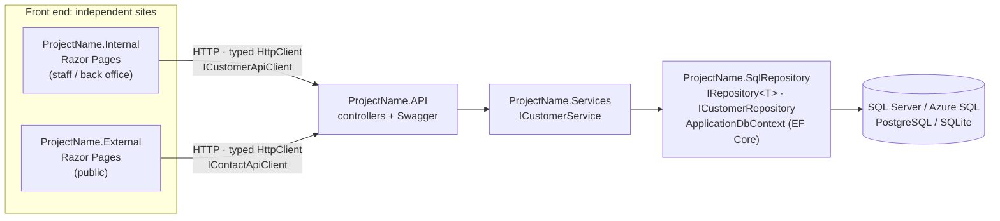
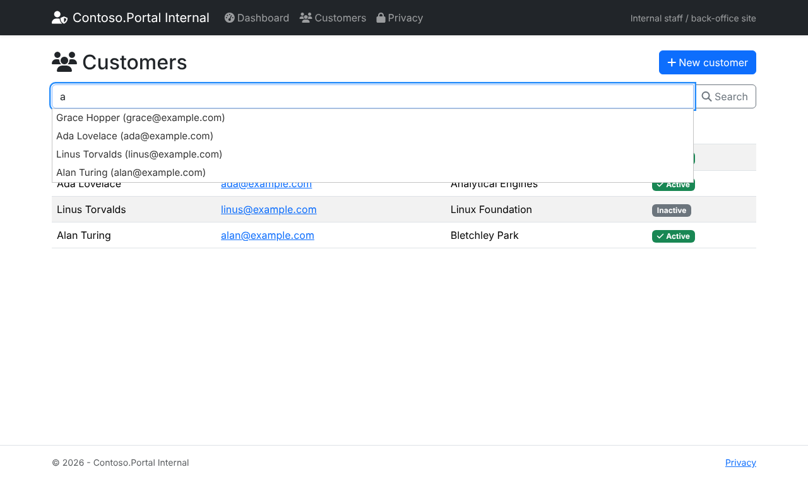
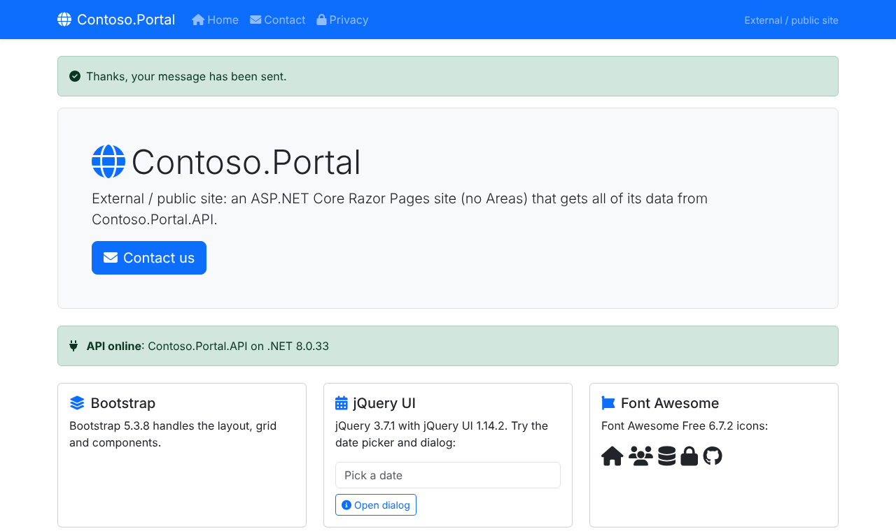

# Razor Pages Solution Template

A `dotnet new` and Visual Studio project template that creates an ASP.NET Core solution with **two independent Razor Pages sites** (Internal and External, no Areas). The sites talk **only to an API layer**. The API sits on a Services layer and an EF Core **SqlRepository** project that uses the repository pattern.

When you create a solution, you choose:

- the .NET version (LTS or STS)
- which projects to create
- the database, its version and the connection string
- the jQuery, jQuery UI, Bootstrap and Font Awesome versions, restored with **LibMan**


<sub>Preview of Visual Studio's *Additional information* page, rendered from the template's `ide.host.json` / `template.json` by [`docs/tools/render-wizard-preview.js`](docs/tools/render-wizard-preview.js). The labels, choices and defaults are the real ones. It is not a capture of Visual Studio.</sub>

---

## Contents

1. [What you get](#what-you-get)
2. [Prerequisites](#prerequisites)
3. [Install the template](#install-the-template)
4. [Create a solution in Visual Studio](#create-a-solution-in-visual-studio)
5. [Create a solution from the command line](#create-a-solution-from-the-command-line)
6. [All options](#all-options)
7. [Run the generated solution](#run-the-generated-solution)
8. [Client-side libraries (LibMan)](#client-side-libraries-libman)
9. [Database and EF Core](#database-and-ef-core)
10. [Update or uninstall the template](#update-or-uninstall-the-template)
11. [Troubleshooting](#troubleshooting)
12. [Working on the template](#working-on-the-template)

---

## What you get



| Project | What it contains |
| --- | --- |
| **ProjectName.Internal** | Razor Pages site for staff: dashboard showing API status, customer list with jQuery UI autocomplete, and a create form with validation. Calls the API only, using `ICustomerApiClient` and `IStatusApiClient`. |
| **ProjectName.External** | Public Razor Pages site: home page, and a contact form with a jQuery UI date picker that posts to the API. Calls the API only, using `IContactApiClient` and `IStatusApiClient`. |
| **ProjectName.API** | ASP.NET Core Web API with controllers (`api/customers`, `api/contact-requests`, `api/status`), Swagger UI, problem details, and a `.http` file. The **only** project that touches the data layer. |
| **ProjectName.Services** | Business logic behind interfaces (`ICustomerService` → `CustomerService`) and DTOs. |
| **ProjectName.SqlRepository** | EF Core: `ApplicationDbContext`, entities, `IEntityTypeConfiguration<T>` classes, generic `IRepository<T>` / `Repository<T>`, `ICustomerRepository` / `CustomerRepository`, a design-time factory for migrations, and a development seeder. |

Also included in every solution:

- **Central Package Management.** Every NuGet version is set once, in `Directory.Packages.props`. EF Core and Npgsql versions match the framework you pick.
- **Shared build settings** in `Directory.Build.props`: nullable, implicit usings, and the latest C# version.
- **No database access from the sites.** Internal and External have no project references, no EF Core and no connection string. Each one has its own copy of the API clients, so you can deploy, scale and version them separately.
- **A README in the generated solution** that explains how to run it, add API clients and entities, and use migrations and LibMan.

<details>
<summary>Generated solution layout (command line)</summary>


</details>

### Screenshots of the generated sites

| Internal – dashboard (API status from `GET api/status`) | Internal – customers from `GET api/customers`, jQuery UI autocomplete |
| --- | --- |
|  |  |
| **Internal – API validation (409 duplicate email) shown on the form** | **External – contact form posted to `POST api/contact-requests`** |
|  |  |
| **External – home page with the jQuery UI date picker** | **API – Swagger UI** |
|  |  |

---

## Prerequisites

| Need | Version |
| --- | --- |
| .NET SDK | **8.0** or later. To target .NET 9, 10 or 11, install that SDK as well; installing the newest SDK is enough to build every target. |
| Visual Studio (optional) | **Visual Studio 2022 17.3 or later** (Visual Studio 2026 also works), with the **ASP.NET and web development** workload. Older versions don't show template options in the dialog. |
| Database (optional) | SQL Server LocalDB (installed with Visual Studio), SQL Server 2016–2025, Azure SQL, PostgreSQL 14–18 or nothing at all (SQLite). |

Check your SDKs with `dotnet --list-sdks`.

---

## Install the template

A template installed with `dotnet new install` shows up in **both** the command line and Visual Studio's **New Project** dialog. Install it once per machine.

### Option A – install the NuGet package (recommended for a team)

Build the package from this repo (or download `template-package` from the GitHub Actions run):

```powershell
# Windows (PowerShell)
.\build\install-template.ps1
```

```bash
# macOS / Linux
./build/install-template.sh
```

Each script runs `dotnet pack` into `artifacts/`, then `dotnet new install artifacts/DotNetAppDev.RazorSolution.Templates.<version>.nupkg`.

To do the same by hand:

```bash
dotnet pack DotNetAppDev.RazorSolution.Templates.csproj -c Release -o artifacts
dotnet new install artifacts/DotNetAppDev.RazorSolution.Templates.1.0.0.nupkg
```


### Option B – from a NuGet feed (Azure Artifacts, GitHub Packages, nuget.org)

Push the `.nupkg` to your feed once:

```bash
dotnet nuget push artifacts/DotNetAppDev.RazorSolution.Templates.1.0.0.nupkg --source <your-feed> --api-key <key>
```

Then everyone installs it by name:

```bash
dotnet new install DotNetAppDev.RazorSolution.Templates
# or from a specific feed
dotnet new install DotNetAppDev.RazorSolution.Templates --add-source https://pkgs.dev.azure.com/<org>/_packaging/<feed>/nuget/v3/index.json
```

### Option C – from the source folder (when changing the template)

```bash
dotnet new install ./templates/RazorSolution
```

Changes to the folder take effect the next time you run `dotnet new` (reinstall with `--force` if they don't).

### Check it is installed

```bash
dotnet new list razorsln
```

---

## Create a solution in Visual Studio

1. **Restart Visual Studio** after installing (or updating) the template so it reloads the template list.
2. **File → New → Project…** (or **Create a new project** on the start window).
3. Search for **Razor Pages Solution**, or filter **Language: C#**, **Project type: Web**. Select it and click **Next**.
4. **Configure your new project:** enter the name, for example `MyCompany.Portal`. Every project is named `<name>.Internal`, `<name>.API` and so on. Choose a location, then click **Next**.
5. **Additional information:** choose your options (see the next sections) and click **Create**.

**Framework.** The LTS/STS choices map to target frameworks, and EF Core and Npgsql versions follow automatically.


**Projects.**
- Tick the sites and layers you want.
- **API is always created when Internal or External is ticked**, because the sites only talk to the API.
- **Services also adds SqlRepository.**

**Database.**
- Pick the provider and version. SQL Server versions set EF Core's compatibility level (130–170). Azure SQL also turns on retry-on-failure.
- Leave server, name, user and password blank for sensible local defaults, or paste a full connection string.


**Client-side libraries (LibMan).** Pick the jQuery, jQuery UI, Bootstrap and Font Awesome versions. They go into each site's `libman.json`.


Visual Studio remembers your project choices (checkboxes and versions) for the next time you use the template. It does not remember connection details.

<details>
<summary>Dark theme</summary>


</details>

After the solution opens, set the startup projects. See [Run the generated solution](#run-the-generated-solution).

---

## Create a solution from the command line

```bash
dotnet new razorsln -n MyCompany.Portal
```

That uses every default: .NET 8, all five projects, SQL Server 2022 on LocalDB with Windows authentication, jQuery 3.7.1, jQuery UI 1.14.2, Bootstrap 5.3.8 and Font Awesome 6.7.2.

More examples:

```bash
# .NET 10, PostgreSQL 17, only the Internal site
dotnet new razorsln -n MyCompany.Backoffice -f net10.0 --external false \
    --database PostgreSQL --postgres-version 17 --db-user portal --db-password "Dev_pass1"

# SQL Server 2019 with a SQL login on a named server
dotnet new razorsln -n MyCompany.Portal --sql-version SqlServer2019 --db-auth SqlLogin \
    --db-server "SQL01\APPS" --db-name Portal --db-user portal_app --db-password "S3cret!"

# Azure SQL with Entra ID (Active Directory Default)
dotnet new razorsln -n MyCompany.Portal --sql-version AzureSql --db-server contoso.database.windows.net

# Your own connection string
dotnet new razorsln -n MyCompany.Portal \
    --connection-string "Server=.\SQLEXPRESS;Database=Portal;Trusted_Connection=True;TrustServerCertificate=True"

# Older front-end stack
dotnet new razorsln -n MyCompany.Legacy --bootstrap 4.6.2 --jquery 3.6.4 --jquery-ui 1.13.3 --fontawesome 5.15.4

# API + data layer only (no sites)
dotnet new razorsln -n MyCompany.Api --internal false --external false

# See exactly what would be created
dotnet new razorsln -n MyCompany.Portal --dry-run
```

`dotnet new razorsln --help` lists every option:


---

## All options

| Option | Visual Studio | CLI | Values (default **bold**) |
| --- | --- | --- | --- |
| .NET version | Framework | `-f`, `--framework` | **`net8.0`** (LTS), `net9.0` (STS), `net10.0` (LTS), `net11.0` (STS, preview) |
| Internal site | Create ProjectName.Internal | `--internal` | **`true`** / `false` |
| External site | Create ProjectName.External | `--external` | **`true`** / `false` |
| API | Create ProjectName.API | `--api` | **`true`** / `false`. Always created if a site is selected |
| Services | Create ProjectName.Services | `--services` | **`true`** / `false`. Also adds SqlRepository |
| SqlRepository | Create ProjectName.SqlRepository | `--sql-repository` | **`true`** / `false` |
| Database | Database | `--database` | **`SqlServer`**, `PostgreSQL`, `Sqlite` |
| SQL Server version | SQL Server version | `--sql-version` | `SqlServer2016` (130), `SqlServer2017` (140), `SqlServer2019` (150), **`SqlServer2022`** (160), `SqlServer2025` (170), `AzureSql` |
| PostgreSQL version | PostgreSQL version | `--postgres-version` | `14`, `15`, `16`, **`17`**, `18` |
| Authentication | Database authentication | `--db-auth` | **`Integrated`** (Windows; Entra ID on Azure SQL), `SqlLogin` |
| Server | Database server | `--db-server` | blank → `(localdb)\MSSQLLocalDB`, `your-server.database.windows.net` or `localhost` |
| Database name | Database name | `--db-name` | blank → the solution name |
| User / password | Database user / password | `--db-user`, `--db-password` | blank → `sa` or `postgres` / `Your_password123` |
| Connection string | Connection string (optional) | `--connection-string` | overrides server, name, user and password |
| jQuery | jQuery version | `--jquery` | `4.0.0`, **`3.7.1`**, `3.6.4` |
| jQuery UI | jQuery UI version | `--jquery-ui` | **`1.14.2`**, `1.13.3` |
| Bootstrap | Bootstrap version | `--bootstrap` | **`5.3.8`**, `5.2.3`, `4.6.2` (the layout markup adapts to Bootstrap 4) |
| Font Awesome | Font Awesome version | `--fontawesome` | `7.3.1`, **`6.7.2`**, `5.15.4` |
| Skip restore | (not shown) | `--no-restore` | Don't run `dotnet restore` after creating |

Connection-string values are escaped for JSON and C#, so backslashes (`.\SQLEXPRESS`) and quotes in passwords are safe. The connection string goes only into **`ProjectName.API/appsettings.json`** (plus `DatabaseDefaults.cs`, which the EF tools use). The sites don't have one.

---

## Run the generated solution

The sites need the API running.

### Visual Studio

1. Right-click the solution → **Configure Startup Projects…**
2. Choose **Multiple startup projects**. Set **ProjectName.API**, **ProjectName.Internal** and **ProjectName.External** to **Start**, and move the API to the top.
3. Press **F5**. Each project opens its own browser tab, and the API opens on `/swagger`.

### Command line

```bash
dotnet dev-certs https --trust      # once per machine
dotnet run --project src/MyCompany.Portal.API --launch-profile https
dotnet run --project src/MyCompany.Portal.Internal --launch-profile https
dotnet run --project src/MyCompany.Portal.External --launch-profile https
```

### How the sites find the API

| Where | Value |
| --- | --- |
| `appsettings.Development.json` (each site) | `"Api": { "BaseUrl": "https://localhost:<API https port>/" }` |
| `launchSettings.json` → `http` profile | `Api__BaseUrl=http://localhost:<API http port>/`, so http-only runs work |
| `appsettings.json` / environment / Key Vault | your deployed API URL, for example `Api__BaseUrl=https://api.mycompany.com/` |

If the API is down, the sites still load. They show an **API offline** banner or message instead of throwing.

---

## Client-side libraries (LibMan)

Each site has its own `libman.json` (provider **jsDelivr**). It installs:

| Library | Files |
| --- | --- |
| jQuery | `wwwroot/lib/jquery/dist/jquery.min.js` |
| jQuery UI (base theme) | `wwwroot/lib/jquery-ui/dist/jquery-ui.min.js`, `…/themes/base/jquery-ui.min.css` and icons |
| Bootstrap | `wwwroot/lib/bootstrap/dist/css/bootstrap.min.css`, `…/js/bootstrap.bundle.min.js` |
| Font Awesome Free | `wwwroot/lib/fontawesome/css/all.min.css` and `webfonts/*.woff2` |
| jQuery Validation + Unobtrusive | used by the forms (`_ValidationScriptsPartial`) |

How the libraries are restored:

- **On build.** The `Microsoft.Web.LibraryManager.Build` package restores `libman.json` before every build, in Visual Studio, `dotnet build` and CI. `wwwroot/lib` is git-ignored, so a fresh clone needs no extra step.
- **In Visual Studio.** Saving `libman.json` restores straight away. Right-click `libman.json` → **Restore Client-Side Libraries**. Right-click the project → **Add → Client-Side Library…** to add another one.
- **From the command line.** `dotnet tool install -g Microsoft.Web.LibraryManager.Cli`, then run `libman restore` or `libman install <lib>@<version> -p jsdelivr -d wwwroot/lib/<lib>` in the site folder.
- **To upgrade** (for example Bootstrap 5.3.8 → 5.3.9), change the `@version` in **both** sites' `libman.json` and build.
- **Parallel builds.** `Directory.Build.targets` retries the LibMan restore once, in case two sites download a new version into the LibMan cache at the same moment during a parallel build.

---

## Database and EF Core

- In Development, the **API** creates the database on startup. It uses `EnsureCreated` until you add a migration, then switches to `Migrate`. It also seeds four sample customers.
- Migrations come from the SqlRepository project. A design-time factory means no startup project is needed:

  ```bash
  dotnet tool install --global dotnet-ef
  dotnet ef migrations add InitialCreate --project src/MyCompany.Portal.SqlRepository
  dotnet ef database update --project src/MyCompany.Portal.SqlRepository
  ```

  In Visual Studio's Package Manager Console, set **Default project** to `*.SqlRepository`, then run `Add-Migration InitialCreate` and `Update-Database`.
- Keep real passwords in user-secrets:
  `dotnet user-secrets set "ConnectionStrings:DefaultConnection" "<conn>" --project src/MyCompany.Portal.API`
- To add an entity, follow the steps in the generated solution's README: entity → configuration → `DbSet` → `IXxxRepository`/`XxxRepository` → service → controller → API client in the site.

---

## Update or uninstall the template

```bash
# update: build a new version (bump <PackageVersion> in the .csproj) and reinstall
dotnet new install artifacts/DotNetAppDev.RazorSolution.Templates.1.1.0.nupkg --force
# or, from a feed
dotnet new update

# uninstall
dotnet new uninstall DotNetAppDev.RazorSolution.Templates
# (installed from the folder?) dotnet new uninstall <full path to templates/RazorSolution>
```

Restart Visual Studio after you install, update or uninstall.

---

## Troubleshooting

| Problem | Fix |
| --- | --- |
| The template is missing from Visual Studio's New Project dialog | Run `dotnet new list razorsln` to confirm it is installed for the same user, then restart Visual Studio. Make sure you're on VS 2022 17.3 or later. In VS 2019/early 2022, also enable **Tools → Options → Environment → Preview Features → Show all .NET Core templates in the New project dialog**. |
| The options aren't shown in Visual Studio | VS older than 17.3 ignores `ide.host.json` options. Update Visual Studio, or create the solution with the CLI. |
| "API offline" on the site | Start the API, or check `Api:BaseUrl`. On first run, trust the dev certificate with `dotnet dev-certs https --trust`, or use the `http` launch profiles. |
| LibMan errors during build | Check that `cdn.jsdelivr.net` is reachable. Behind a proxy, set `HTTPS_PROXY`. Build again, because a restored library is cached in `%LocalAppData%\.librarymanager`. |
| `Cannot open database` / LocalDB not found | Install SQL Server Express LocalDB (part of the VS ASP.NET workload), or change `ConnectionStrings:DefaultConnection` in the API. |
| The .NET 11 option fails to restore | .NET 11 uses preview packages. Install the .NET 11 preview SDK, or pick .NET 8/9/10. |

---

## Working on the template

| Path | What |
| --- | --- |
| `templates/RazorSolution/` | The template content: a source solution named `TemplateApp`, which becomes your project name. |
| `…/.template.config/template.json` | Parameters, conditional files, and generated values: EF/Npgsql/Swashbuckle versions per framework, SQL compatibility level, escaped connection-string parts, ports. |
| `…/.template.config/ide.host.json` | Visual Studio dialog: which options are shown, with their labels and tooltips. |
| `…/.template.config/dotnetcli.host.json` | CLI switch names (`--internal`, `--database`, `--bootstrap`, …). |
| `DotNetAppDev.RazorSolution.Templates.csproj` | Packs `templates/**` into the NuGet template package. |
| `tests/test-template.sh` | Creates and builds 9 option combinations: every framework and database, Bootstrap 4/5, single site, API only, repository without services, custom connection string, escaped passwords. |
| `docs/tools/render-wizard-preview.js` | Regenerates the wizard preview images in `docs/images` from `template.json` / `ide.host.json`. |
| `.github/workflows/template-tests.yml` | CI: runs the test script and uploads the `.nupkg`. |

### Changing versions

- **New .NET release:** add a `Framework` choice in `template.json` and a case to the `EfCoreVersion`, `NpgsqlVersion` and `SwashbuckleVersion` switches.
- **New front-end version:** add a `choices` entry to `JQueryVersion`, `JQueryUIVersion`, `BootstrapVersion` or `FontAwesomeVersion`. Any version published on npm works, because LibMan uses jsDelivr.
- **New SQL Server version:** add a `SqlServerVersion` choice and a `SqlCompatibilityLevel` case.

After a change, run:

```bash
tests/test-template.sh                       # builds every combination
node docs/tools/render-wizard-preview.js     # refreshes the wizard screenshots
```

Template source files contain tokens such as `__BOOTSTRAP_VERSION__` and `__EFCORE_VERSION__`. They are replaced when a solution is created, so test the generated output, not `templates/RazorSolution` itself.
